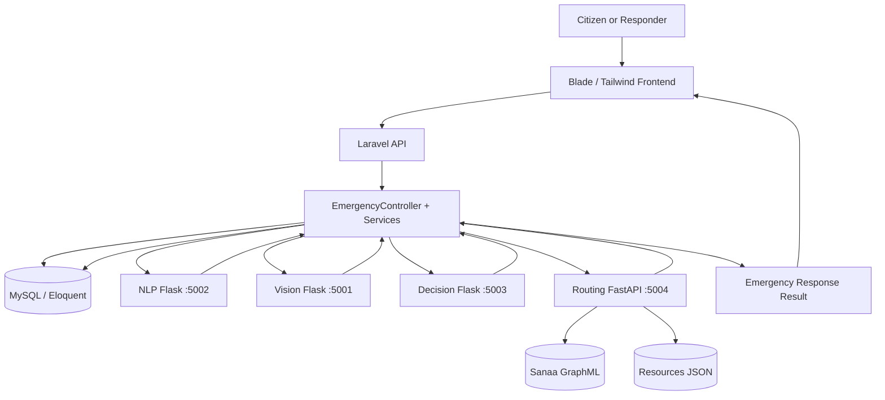

# Multimodal AI Emergency Response System
## Complete Project Analysis & Viva Preparation

---

> **Document status:** Complete analysis of the repository as inspected on 2026-09-07.
>
> **Important accuracy rule:** This document distinguishes implemented code from planned or placeholder documentation. The repository contains a working prototype across several services, but it is not yet a production-ready emergency dispatch platform.

# 1. Project Overview

## 1.1 هدف المشروع

يهدف المشروع إلى بناء نظام استجابة للطوارئ متعدد الوسائط. يستقبل النظام بلاغ المواطن من خلال وصف نصي، أو صورة، أو الاثنين معًا، مع الموقع الجغرافي للحادث. بعد ذلك يحلل النظام المدخلات بواسطة خدمات ذكاء اصطناعي، يدمج النتائج في قرار واحد، ثم يختار أقرب مورد استجابة مناسب ويحسب مسار الوصول إليه.

الهدف العملي هو تقليل زمن فرز البلاغات ومساعدة فرق الاستجابة على معرفة:

- نوع الطارئ المحتمل.
- درجة الخطورة والأولوية.
- نوع الاستجابة المطلوب.
- المورد أو الفريق الأقرب.
- المسار الجغرافي التقديري للوصول.

## 1.2 المشكلة التي يحلها

البلاغات الواقعية قد تصل بصيغ مختلفة وغير منظمة. قد يكتب المستخدم وصفًا مختصرًا، أو يرفع صورة، أو يقدم النوعين معًا. الاعتماد على مصدر واحد قد يؤدي إلى تصنيف ناقص أو غير دقيق. لذلك يستخدم المشروع:

1. تحليل النص لاستخراج نوع الطارئ ودرجة الإلحاح.
2. تحليل الصورة للتعرف على مشاهد مثل الحريق أو الفيضان أو الحادث.
3. دمج النتيجتين في محرك قرار واحد.
4. اختيار مورد مناسب على شبكة طرق جغرافية.

المشكلة التي يعالجها المشروع هي تحويل البلاغ الخام إلى قرار قابل للتنفيذ. لكنه لا يزال نموذجًا أوليًا؛ فلا توجد حتى الآن حركة مرور لحظية، أو إدارة تشغيلية كاملة للموارد، أو نظام صلاحيات إنتاجي مكتمل.

## 1.3 المستخدمون

- **المواطن:** يرسل البلاغ، الوصف، الصورة، والموقع، ويتابع حالة البلاغ.
- **المستجيب أو المشرف:** يراجع البلاغات، يرى تفاصيل الطوارئ، يتابع الخريطة، ويغير حالة البلاغ عبر واجهة العرض الحالية.
- **خدمات الذكاء الاصطناعي:** تستقبل مدخلات محددة وتعيد نتائج تحليل منظمة.
- **النظام الخلفي:** ينسق الخدمات ويحفظ النتائج في قاعدة البيانات.

## 1.4 المكونات الرئيسية

| المكون | الوظيفة | الحالة الفعلية |
|---|---|---|
| Laravel Backend | API، صفحات الويب، التنسيق، حفظ البيانات | منفذ جزئيًا |
| MySQL | حفظ البلاغات ونتائج AI والتوجيه | منفذ عبر migrations |
| NLP Service | تحليل النص وتصنيف الطوارئ والأولوية | منفذ كخدمة Flask |
| Vision Service | تصنيف الصور واستخراج نتيجة بصرية | منفذ كخدمة Flask |
| Decision Service | دمج NLP وVision وحساب الخطر | منفذ كخدمة Flask واختبارات وحدات |
| Routing Service | اختيار المورد وحساب الطريق | منفذ كخدمة FastAPI |
| Blade/Tailwind Frontend | نماذج المواطن ولوحات العرض | منفذ كنموذج أولي |
| Authentication | جلسات Laravel وبعض صفحات الدخول | غير مكتمل |

## 1.5 التقنيات المستخدمة

- **Backend:** PHP 8.2+، Laravel 12، Eloquent ORM.
- **Database:** MySQL عبر XAMPP، مع Laravel migrations.
- **Frontend:** Blade، Tailwind CSS 4، Vite، Axios، JavaScript.
- **NLP:** Python، Flask، PyTorch، NumPy، نموذج BiLSTM ثنائي الاتجاه مع Attention.
- **Vision:** Python، Flask، TensorFlow/Keras، Pillow، NumPy.
- **Decision:** Python، Flask، dataclasses، قواعد دمج حتمية.
- **Routing:** Python، FastAPI، Pydantic، OSMnx، NetworkX، GraphML، خوارزميتا A* وDijkstra.
- **Testing:** PHPUnit/Laravel tests، unittest لمحرك القرار، واختبار نصي لخدمة التوجيه.
- **Infrastructure المحلي:** XAMPP، Apache، MySQL، وخدمات Python منفصلة.

## 1.6 حدود التحليل

الوثائق القديمة في المشروع ما زالت تحتوي على `TBD` وتصف مرحلة قاعدة البيانات فقط، بينما الكود الحالي أوسع من ذلك. لذلك يعتمد هذا الملف على الكود الموجود أولًا، ويشير صراحة إلى التناقضات بدل اعتبار الوثائق القديمة مصدرًا نهائيًا.

# 2. Complete Project Structure

## 2.1 Tree المشروع

> تم تضمين ملفات ومجلدات المصدر والاختبارات والوثائق والموارد المهمة. مجلدات الاعتماديات والمخرجات المولدة الكبيرة مذكورة في الأسفل بدل نسخ كل ملف داخلي فيها.

```text
Multimodal_AI_Emergency_Response_System/
├── README.md
├── CHANGELOG.md
├── docs/
│   ├── PROJECT_COMPLETE_ANALYSIS.md
│   ├── api.md
│   ├── architecture.md
│   ├── backend-requirements.md
│   ├── database.md
│   ├── decisions.md
│   ├── integration-dependencies.md
│   ├── project-scope.md
│   ├── roadmap.md
│   ├── s5-scope.md
│   └── security.md
├── backend/
│   ├── artisan
│   ├── composer.json
│   ├── package.json
│   ├── phpunit.xml
│   ├── README.md
│   ├── app/
│   │   ├── Http/
│   │   │   ├── Controllers/
│   │   │   │   ├── Api/EmergencyController.php
│   │   │   │   ├── Auth/
│   │   │   │   ├── Citizen/
│   │   │   │   └── Responder/
│   │   │   └── Middleware/
│   │   ├── Models/
│   │   │   ├── AiResult.php
│   │   │   ├── EmergencyReport.php
│   │   │   ├── RoutingResult.php
│   │   │   └── User.php
│   │   ├── Providers/
│   │   └── Services/
│   │       ├── DecisionService.php
│   │       ├── EmergencyDemoService.php
│   │       ├── EmergencyOrchestrator.php
│   │       ├── NlpService.php
│   │       ├── RoutingService.php
│   │       └── VisionService.php
│   ├── bootstrap/
│   │   ├── app.php
│   │   ├── cache/
│   │   └── providers.php
│   ├── config/
│   │   ├── app.php
│   │   ├── auth.php
│   │   ├── cache.php
│   │   ├── database.php
│   │   ├── filesystems.php
│   │   ├── logging.php
│   │   ├── mail.php
│   │   ├── queue.php
│   │   ├── sanctum.php
│   │   └── services.php
│   ├── database/
│   │   ├── factories/
│   │   ├── migrations/
│   │   │   ├── 0001_01_01_000000_create_users_table.php
│   │   │   ├── 0001_01_01_000001_create_cache_table.php
│   │   │   ├── 0001_01_01_000002_create_jobs_table.php
│   │   │   ├── *_create_emergency_reports_table.php
│   │   │   ├── *_create_ai_results_table.php
│   │   │   └── *_create_routing_results_table.php
│   │   └── seeders/
│   │       └── DatabaseSeeder.php
│   ├── public/
│   │   ├── index.php
│   │   ├── robots.txt
│   │   └── build/
│   ├── resources/
│   │   ├── css/app.css
│   │   ├── js/app.js
│   │   └── views/
│   │       ├── auth/
│   │       ├── citizen/
│   │       ├── layouts/
│   │       ├── pages/
│   │       └── responder/
│   ├── routes/
│   │   ├── api.php
│   │   ├── console.php
│   │   └── web.php
│   ├── storage/
│   │   ├── app/
│   │   ├── framework/
│   │   └── logs/
│   └── tests/
│       ├── TestCase.php
│       ├── Feature/
│       │   ├── EmergencyReportTest.php
│       │   ├── FrontendRoutesTest.php
│       │   └── ExampleTest.php
│       └── Unit/ExampleTest.php
├── decision-service/
│   ├── api.py
│   ├── decision_engine.py
│   ├── requirements.txt
│   ├── curl_examples.sh
│   ├── README.md
│   └── test_decision_engine.py
├── nlp_service/
│   ├── predict.py
│   ├── text_api.py
│   ├── HumAID_priority_training_ready_planB.csv
│   ├── S1_DistilBERT_Local_Model_FINAL.ipynb
│   └── s1_emergency_bilstm_model0.2.pt
├── vision-service/
│   ├── cv_api.py
│   ├── predict.py
│   ├── train.py
│   ├── README.md
│   ├── models/image_model.keras
│   ├── outputs/class_names.json
│   └── temp/
└── routing/
    ├── cache/*.json
    ├── data/
    │   ├── emergencies/
    │   ├── maps/sanaa_drive.graphml
    │   └── resources/
    │       ├── resources.json
    │       └── resources_with_nodes.json
    ├── src/
    │   ├── api/routing_api.py
    │   ├── graph/
    │   │   ├── osm_graph.py
    │   │   └── node_mapping.py
    │   ├── map/
    │   ├── resource_selection/
    │   │   ├── resource_loader.py
    │   │   └── select_resource.py
    │   └── routing/
    │       ├── a_star.py
    │       └── dijkstra.py
    ├── tests/
    │   ├── main.py
    │   ├── requirements.txt
    │   └── test_routing_system.py
    └── cache/
```

### الاعتماديات والمخرجات المستبعدة من التفصيل

- `backend/vendor/`: مكتبات Composer المثبتة، وليست كود المشروع الأساسي.
- `backend/node_modules/` إن وجدت: مكتبات JavaScript المثبتة.
- `backend/storage/framework/` و`backend/public/build/`: ملفات تشغيل أو build مولدة.
- `routing/cache/`: نتائج تخزين مؤقت مولدة.
- ملفات النماذج الكبيرة مثل `.pt` و`.keras` وGraphML: موارد تشغيلية، وليست ملفات مصدر نصية.

## 2.2 وظيفة المجلدات المهمة

| المجلد | الوظيفة |
|---|---|
| `backend/app` | منطق Laravel: Controllers، Models، Services، وProviders. |
| `backend/routes` | تعريف مسارات الويب وAPI. |
| `backend/database` | migrations، factories، seeders وبنية قاعدة البيانات. |
| `backend/resources` | واجهة Blade وCSS وJavaScript. |
| `backend/tests` | اختبارات Laravel الوظيفية والوحدات. |
| `decision-service` | خدمة الدمج والقرار المستقلة. |
| `nlp_service` | خدمة تحليل النص والنموذج المدرب. |
| `vision-service` | خدمة تصنيف الصور والنموذج المدرب. |
| `routing/src` | خدمة الخرائط، تحميل الرسم البياني، اختيار المورد، وحساب المسار. |
| `routing/data` | شبكة طرق صنعاء وبيانات الموارد. |
| `docs` | وثائق المتطلبات والقرارات والتحليل الحالي. |

# 3. System Architecture

## 3.1 النظرة المعمارية

النظام مقسم إلى Laravel باعتباره نقطة الدخول والمنسق، وخدمات Python متخصصة لكل مرحلة AI أو Routing. قاعدة البيانات لا تحفظ البلاغ فقط، بل تحفظ أيضًا نتيجة الدمج ونتيجة التوجيه المرتبطة به.



## 3.2 تدفق البلاغ الفعلي

1. يرسل العميل `POST /api/emergencies` مع `text` أو `image` وموقع `latitude/longitude`.
2. يتحقق `EmergencyController` من البيانات.
3. ينشئ Laravel سجل `EmergencyReport` بحالة أولية.
4. ينشئ معرفًا بصيغة مثل `EMG-000001`.
5. يستدعي NLP إذا كان النص موجودًا.
6. يستدعي Vision إذا كانت الصورة موجودة.
7. يستدعي `DecisionService` بالنتائج المتاحة والموقع.
8. يحفظ `AiResult` مع النوع النهائي، الخطر، الأولوية، الثقة، والكيانات.
9. إذا كان النوع النهائي `Normal` ينهي البلاغ دون Routing.
10. إذا كان البلاغ طارئًا، يستدعي `RoutingService` بنوع الاستجابة والموقع.
11. يحفظ `RoutingResult`، بما في ذلك المورد والطريق والمسافة والزمن التقديري.
12. يغير حالة التقرير إلى `completed` ويعيد النتيجة للعميل.

## 3.3 واجهات الخدمات

| الخدمة | المنفذ الافتراضي | الواجهات |
|---|---:|---|
| Vision | 5001 | `GET /health`، `POST /vision/analyze` |
| NLP | 5002 | `GET /health`، `POST /nlp/analyze` |
| Decision | 5003 | `GET /health`، `POST /decision/analyze` |
| Routing | 5004 | `GET /health`، `POST /routing/route` |
| Laravel | حسب Apache أو `php artisan serve` | `POST /api/emergencies` ومسارات الويب |

## 3.4 حالة التنفيذ مقابل الخطة

### منفذ

- نموذج بلاغ وقاعدة بيانات Laravel.
- تنسيق بين Laravel وDecision وRouting، مع خدمات NLP/Vision منفصلة.
- تخزين نتائج AI والتوجيه.
- محرك دمج حتمي ومختبر.
- حساب مسار A* واختيار أقرب مورد.
- واجهات Blade أولية للمواطن والمستجيب.

### غير مكتمل أو مخطط

- API authentication وصلاحيات المواطن والمستجيب.
- ربط المستخدم بالبلاغ ownership.
- بث حي أو تحديث لحظي للبلاغات.
- حركة مرور حية وإغلاقات الطرق.
- إدارة حالة توفر الموارد بشكل تشغيلي.
- معاملات rollback شاملة عند فشل خدمة خارجية.
- اختبارات end-to-end لجميع الخدمات.
- توثيق نهائي موحد لجميع الإعدادات والاعتماديات.

# 4. Backend and API Analysis

## 4.1 Laravel Backend

Laravel هو نقطة التكامل الرئيسية. يستخدم Eloquent للبيانات، Blade للواجهة، وServices لتغليف استدعاءات الخدمات الخارجية. أهم طبقة هي `EmergencyOrchestrator`, التي تنفذ قرارًا وتسجيلاً وتوجيهًا بالترتيب.

### المسارات الرئيسية

- `POST /api/emergencies`: إنشاء ومعالجة بلاغ.
- `GET /api/test-routing`: مسار تجريبي.
- `GET /api/test-orchestrator`: مسار تجريبي.

مسارات الويب تشمل الصفحات العامة، تسجيل الدخول والتسجيل، صفحات المواطن، وصفحات المستجيب. وجود المسار لا يعني أن الحماية أو المنطق التشغيلي مكتملان.

## 4.2 شكل طلب البلاغ

```json
{
  "text": "There is a major fire near the road",
  "image": "data:image/jpeg;base64,...",
  "location": {
    "latitude": 15.3694,
    "longitude": 44.191
  }
}
```

`text` و`image` اختياريان منفردًا، لكن يجب وجود واحد منهما على الأقل. الموقع مطلوب. التحقق الحالي يتأكد من النوع وبعض القيود النصية، لكنه لا يفرض نطاق latitude/longitude في Laravel ولا يتحقق بشكل قوي من حجم الصورة أو نوعها.

## 4.3 شكل النتيجة

النتيجة العامة تحتوي عادة على:

- `emergency_id`.
- `status`.
- `decision`: النوع النهائي، نوع الاستجابة، risk score، priority، confidence، والموقع.
- `routing`: المورد والمسار والمسافة والزمن أو `null` للحالة `Normal`.

## 4.4 تخزين الملفات والصور

خدمة Vision تستقبل Base64 وتكتب صورة مؤقتة ثم تحذفها في `finally`. هذا يمنع بقاء الملف المؤقت في الحالة الطبيعية، لكنه لا يغني عن التحقق من MIME، الحجم، الامتداد، ورفض payloads الضخمة.

# 5. Database and Domain Model

## 5.1 الجداول

- `users`, `password_reset_tokens`, `sessions`.
- `cache`, `cache_locks`.
- `jobs`, `job_batches`, `failed_jobs`.
- `personal_access_tokens` عبر Sanctum.
- `emergency_reports`.
- `ai_results`.
- `routing_results`.

## 5.2 EmergencyReport

يحفظ:

- `emergency_id`.
- `description`.
- `image`.
- `latitude` و`longitude`.
- `status`.
- timestamps.

ويرتبط بعلاقة واحدة مع `AiResult` وعلاقة واحدة مع `RoutingResult`.

## 5.3 AiResult

يحفظ:

- إلحاح النص `text_urgency`.
- نوع النص `emergency_type`.
- نوع الصورة `image_type`.
- النوع النهائي `final_type`.
- نوع الاستجابة `response_type`.
- `risk_score`.
- `priority`.
- `confidence`.
- `entities` المستخرجة من النص.

## 5.4 RoutingResult

يحفظ:

- هل يوجد مورد.
- معرف المورد ونوعه واسمه.
- إحداثيات المورد.
- قائمة إحداثيات الطريق.
- المسافة بالكيلومتر.
- الزمن التقديري بالدقائق.

العلاقات تستخدم foreign keys مع cascade عند حذف البلاغ، ويُفترض وجود نتيجة واحدة لكل بلاغ عبر unique constraint.

## 5.5 ملاحظات تصميمية

- لا يوجد ربط واضح بين `emergency_reports` و`users`، لذلك لا توجد ملكية بلاغ رسمية.
- `status` نصي وليس enum أو state machine.
- لا يوجد audit log لتغييرات الحالة أو قرارات الإرسال.
- لا توجد استراتيجية مكتملة للفهرسة الجغرافية أو الاحتفاظ بالبيانات.
- بعض وثائق قاعدة البيانات القديمة تقول إن الوصف غير nullable، بينما دعم البلاغ الصوري جعل الكود الحالي يسمح بمدخلات متعددة الوسائط.

# 6. AI Services

## 6.1 NLP Service

تستخدم الخدمة Flask وتستمع افتراضيًا على `5002`. تستقبل `emergency_id` و`text` عبر `POST /nlp/analyze`.

النموذج هو PyTorch BiLSTM ثنائي الاتجاه بطبقتين مع Attention ورأسي تصنيف: نوع الطوارئ والأولوية. الحد الأقصى للنص هو 50 token تقريبًا، مع معالجة للكلمات غير المعروفة. كما توجد عملية استخراج كيانات بسيطة تعتمد على regex ومصطلحات موقع أساسية.

الناتج يتضمن عادة:

- `text_urgency` من 0 إلى 100.
- `emergency_type`.
- `priority` واحتمالاتها.
- embedding النص.
- `entities`.

القيود:

- لا يوجد `requirements.txt` خاص بـ NLP.
- لا توجد اختبارات خدمة مستقلة ظاهرة.
- استخراج الكيانات ليس نظام NER كاملًا.
- جودة النموذج مرتبطة ببيانات التدريب والنموذج الموجود، ولا توجد في المشروع الحالي مؤشرات تقييم تشغيلية كافية.

## 6.2 Vision Service

تستخدم Flask وتستمع افتراضيًا على `5001`. تفك Base64، تحفظ JPEG مؤقتًا، تغير الحجم إلى `224x224`، تطبع القيم إلى `[0,1]`، ثم تشغل نموذج Keras الموجود في `models/image_model.keras`.

الفئات الموجودة في `outputs/class_names.json` هي:

- `Earthquake`.
- `Fire`.
- `Flood`.
- `No Emergency`.
- `Traffic Accident`.

تقوم طبقة Laravel بتطبيع بعض التسميات إلى `Traffic_Accident` و`Normal` لتطابق عقد القرار.

القيود الرئيسية:

- لا يوجد حد واضح لحجم الصورة.
- لا يوجد تحقق صريح قوي من MIME أو سلامة Base64.
- الأخطاء تعيد رسالة exception مباشرة في بعض الحالات.
- تحميل النموذج يتم عند import، مما يزيد زمن بدء الخدمة ويزيد الاعتماد على الذاكرة.
- لا توجد suite اختبارات واضحة للخدمة.

## 6.3 Decision/Fusion Service

الخدمة مبنية بـ Flask على المنفذ `5003`. الأنواع المدعومة:

`Fire`, `Flood`, `Earthquake`, `Traffic_Accident`, `Medical_Emergency`, `Other`, `Normal`.

قواعد الدمج:

- عند توافق NLP وVision: وزن 50% لكل مصدر.
- عند التعارض: Vision بوزن 55% وNLP بوزن 45%.
- عند وجود مصدر واحد: تخفيض الثقة بنسبة 30%.
- `Normal` يفرض `risk_score = 0`.
- الأولوية: `critical` من 85، `high` من 60، `medium` من 30، وإلا `low`.
- Fire وEarthquake مع risk score لا يقل عن 75 يحصلان على critical override ودرجة لا تقل عن 90.

خريطة الاستجابة:

| النوع النهائي | نوع الاستجابة |
|---|---|
| Fire | Fire_Rescue |
| Traffic_Accident | Ambulance |
| Medical_Emergency | Ambulance |
| Flood | Rescue_Team |
| Earthquake | Rescue_Team |
| Other | General_Response |
| Normal | No_Response |

الخدمة لديها 11 اختبارًا لوحدة القرار تغطي الاتفاق والتعارض والمصدر الواحد والحالة الطبيعية والتجاوز الحرج والتحقق من المدخلات وتمرير الموقع.

## 6.4 Routing Service

الخدمة مبنية بـ FastAPI وتستمع افتراضيًا على `5004`. تحمل GraphML لشبكة طرق صنعاء وبيانات الموارد عند بدء التشغيل.

تدفقها:

1. التحقق من إحداثيات الموقع بواسطة Pydantic.
2. إيجاد أقرب عقدة طريق باستخدام OSMnx.
3. تصفية الموارد حسب `response_type`.
4. تشغيل A* لكل مورد صالح.
5. تجاهل المسارات الفاشلة.
6. اختيار أقل مسافة.
7. تحويل عقد الطريق إلى latitude/longitude.
8. حساب الزمن على أساس سرعة افتراضية 30 كم/ساعة.

خوارزمية A* تستخدم مسافة Haversine كـ heuristic وأطوال الحواف كتكلفة. توجد Dijkstra للمقارنة والتحقق.

القيود:

- لا توجد حركة مرور حية.
- لا توجد إغلاقات طرق أو أوزان خاصة بالطوارئ.
- الموارد static في JSON ولا يوجد availability تشغيلي موثق.
- GraphML والبيانات تُحمل عند بدء الخدمة.
- ملف متطلبات الخدمة الكاملة غير موحد في جذر routing.
- بعض بيانات الموارد تحتوي قيمًا غير نظيفة مثل `nan`.

# 7. Frontend and User Experience

الواجهة مبنية باستخدام Blade وTailwind وVite، وتضم:

- صفحات عامة.
- نموذج إرسال بلاغ.
- تحديد الموقع من المتصفح.
- اختيار الصورة ومعاينتها.
- صفحات المواطن للبلاغات والتفاصيل والإشعارات والملف الشخصي.
- لوحة المستجيب، قائمة الطوارئ، الخريطة، التحليلات، الإشعارات والإعدادات.

تستخدم نماذج Blade رموز CSRF، لكن وجود الواجهات لا يعني أن كل البيانات المعروضة متصلة ببيانات تشغيل حقيقية. `EmergencyDemoService` يوفر سجلات تجريبية، وبعض تحليلات المستجيب مثل أزمنة الاستجابة، نسب الحل، الثقة، الاتجاهات الشهرية، وتوزيع الفئات hard-coded.

التوصيف الصحيح للواجهة هو **functional prototype/demo interface** وليس مركز قيادة حيًا.

# 8. Security, Reliability, and Risk Analysis

## 8.1 الموجود حاليًا

- Laravel session guard.
- hashing لكلمات المرور عبر Laravel.
- CSRF في نماذج الويب.
- تحقق أساسي من المدخلات.
- Sanctum migration/package موجودان.
- Pydantic يفرض نطاق الإحداثيات في Routing.

## 8.2 الفجوات المهمة

1. مسارات المواطن والمستجيب ليست محمية بشكل شامل بـ `auth` middleware.
2. تسجيل دخول المستجيب لا ينفذ تحققًا حقيقيًا من بيانات الاعتماد.
3. تدفق دخول المواطن يحتاج التحقق من أن الفشل لا يؤدي إلى dashboard.
4. إعادة تعيين كلمة المرور وتحديث الملف الشخصي غير مكتملين أو لا يحفظان فعليًا.
5. لا توجد أدوار أو Policies أو Gates واضحة.
6. `POST /api/emergencies` غير محمي بـ Sanctum.
7. `User` لا يستخدم `HasApiTokens` حسب التحليل الحالي.
8. لا توجد rate limiting ظاهرة للبلاغات أو الدخول.
9. لا توجد timeout/retry policy واضحة لاستدعاءات Python.
10. لا توجد transaction شاملة؛ قد يبقى التقرير محفوظًا إذا فشل AI أو Routing لاحقًا.
11. بعض APIs تعيد رسالة الخطأ الخام للعميل.
12. Laravel لا يفرض نطاقات latitude/longitude في التحقق الأولي.
13. لا توجد idempotency key لمنع تكرار البلاغات عند إعادة الطلب.
14. لا توجد audit trail غير قابلة للتعديل لقرارات الطوارئ وتغييرات الحالة.
15. إعدادات debug والأسرار يجب ضبطها قبل أي نشر حقيقي.

# 9. Testing and Quality

## 9.1 الاختبارات الموجودة

### Laravel

- إنشاء EmergencyReport.
- الحالة الافتراضية.
- الصورة nullable وتخزين مسارها.
- عرض الصفحات العامة وصفحات المصادقة.
- صفحات المواطن والمستجيب.
- تحديث حالة البلاغ في الواجهة.

### Decision

اختبارات وحدات لمحرك الدمج وعددها المعلن 11، وتشمل حالات التوافق والتعارض والمصادر المفردة وNormal وcritical override والتحقق من الأخطاء.

### Routing

الاختبار النصي يغطي وجود الرسم البياني، العقد والإحداثيات، الموارد، mapping، Dijkstra، A*، اتفاق المسافات، تصفية الموارد، اختيار الأفضل، وصحة المسار.

## 9.2 الفجوات الاختبارية

- لا يوجد اختبار تكاملي كامل من API إلى NLP/Vision إلى Decision إلى Routing.
- لا يوجد اختبار لفشل أو timeout إحدى الخدمات.
- لا يوجد اختبار transaction rollback.
- لا يوجد اختبار API authentication وauthorization.
- لا يوجد اختبار قوي لحجم ونوع الصور وBase64 غير الصالح.
- لا يوجد اختبار لتزامن إنشاء `emergency_id`.
- لا يوجد اختبار end-to-end للبلاغ النصي والصوري معًا.
- اختبار Routing أقرب إلى script harness من suite قياسية مثل pytest.

## 9.3 أوامر التحقق المقترحة

```bash
cd backend
php artisan test

cd ../decision-service
python -m unittest test_decision_engine.py -v
```

يجب إضافة اختبارات الخدمة والتكامل قبل اعتبار النظام جاهزًا للنشر.

# 10. Installation and Operation

## 10.1 Backend

```bash
cd backend
composer install
cp .env.example .env
php artisan key:generate
php artisan migrate
npm install
npm run build
php artisan test
php artisan serve
```

يجب ضبط MySQL مثلًا:

```env
DB_CONNECTION=mysql
DB_HOST=127.0.0.1
DB_PORT=3306
DB_DATABASE=emergency_response
DB_USERNAME=root
DB_PASSWORD=
```

## 10.2 Decision

```bash
cd decision-service
pip install -r requirements.txt
python api.py
```

## 10.3 NLP

```bash
cd nlp_service
python text_api.py
```

يجب تثبيت الاعتماديات المستنتجة من imports، وعلى الأقل PyTorch وNumPy، لأن ملف requirements مستقل غير موجود.

## 10.4 Vision

```bash
cd vision-service
python cv_api.py
```

تحتاج الخدمة إلى Flask وTensorFlow وNumPy وPillow، مع التأكد من وجود النموذج والملفات المرافقة.

## 10.5 Routing

خدمة Routing تحتاج FastAPI وUvicorn وPydantic وOSMnx وNetworkX واعتماديات GIS التابعة لها. يجب تشغيلها من مسار يسمح بحل `src` وتحميل GraphML وملفات الموارد. أمر التشغيل الإنتاجي النهائي يحتاج توثيقًا موحدًا قبل النشر.

## 10.6 ترتيب التشغيل

1. تشغيل MySQL وتهيئة قاعدة البيانات.
2. تشغيل NLP على `5002`.
3. تشغيل Vision على `5001`.
4. تشغيل Decision على `5003`.
5. تشغيل Routing على `5004`.
6. ضبط URLs الخدمات في `.env` الخاص بـ Laravel.
7. تشغيل Apache/Laravel وفتح الواجهة.

# 11. Viva Preparation

## 11.1 سؤال: لماذا النظام متعدد الوسائط؟

لأن النص والصورة يقدمان إشارتين مختلفتين. النص قد يشرح الإلحاح أو المكان، والصورة قد تقدم دليلًا بصريًا مباشرًا. الدمج يقلل الاعتماد على مصدر واحد ويسمح بالاستمرار حتى عند توفر مصدر واحد فقط.

## 11.2 سؤال: ماذا يحدث عند تعارض النص والصورة؟

تستخدم قاعدة الدمج وزنًا أعلى قليلًا للرؤية: 55% مقابل 45% للنص، ثم تقلل الثقة النهائية بعامل 0.85. هذا قرار rule-based قابل للشرح، وليس نموذج fusion عميقًا مدربًا end-to-end.

## 11.3 سؤال: لماذا لا يتم استدعاء Routing للحالة Normal؟

لأن `Normal` تعني عدم وجود طارئ، وبالتالي لا توجد حاجة لإرسال مورد. هذا يقلل التكلفة ويمنع dispatch غير ضروري.

## 11.4 سؤال: كيف يختار النظام المورد؟

يحدد أقرب عقدة طريق لموقع البلاغ، يرشح الموارد حسب نوع الاستجابة، يحسب مسار A* لكل مورد صالح، ثم يختار المورد ذي أقل مسافة ناجحة.

## 11.5 سؤال: هل الزمن واقعي؟

هو تقديري فقط، إذ يحسب من المسافة وسرعة ثابتة 30 كم/ساعة. لا يعتمد على traffic live أو إغلاقات الطرق.

## 11.6 سؤال: ما أهم نقطة ضعف أمنية؟

غياب حماية وصلاحيات مكتملة لمسارات API وصفحات المستجيب، مع عدم اكتمال Sanctum والأدوار. قبل الإنتاج يجب إضافة authentication وauthorization وrate limiting والتحقق الصارم من المدخلات.

## 11.7 سؤال: هل النظام production-ready؟

لا. هو prototype متقدم يثبت تدفق التكامل، لكن يحتاج معاملات موثوقة، اختبارات end-to-end، إدارة فشل الخدمات، حماية API، مراقبة، إدارة موارد حقيقية، وتوثيق تشغيل كامل.

# 12. Recommended Next Steps

1. إضافة `auth:sanctum` أو استراتيجية API موحدة، ثم بناء roles وPolicies.
2. ربط كل بلاغ بالمستخدم وتطبيق ownership.
3. وضع Laravel HTTP clients داخل timeout/retry/circuit-breaker policy.
4. استخدام transaction وحالات فشل صريحة مثل `failed` أو `needs_review`.
5. التحقق من الصور بالحجم وMIME وBase64 قبل الحفظ أو الإرسال.
6. فرض نطاقات الإحداثيات وقيود حجم الطلب.
7. إضافة اختبارات تكامل لجميع الخدمات واختبارات فشل الشبكة.
8. إضافة requirements مقفلة لكل خدمة Python وتوحيد أوامر التشغيل.
9. استبدال بيانات التحليلات التجريبية باستعلامات قاعدة البيانات.
10. إضافة audit log ومراقبة وstructured logging.
11. تحسين Routing بإدارة availability والمرور وإغلاقات الطرق عند توفر البيانات.
12. تحديث الوثائق القديمة التي ما زالت تقول إن الخدمات والـAPI غير منفذة.

# 13. Final Assessment

المشروع يملك أساسًا معماريًا واضحًا: Laravel يعمل كمنسق، خدمات AI متخصصة تعمل بشكل مستقل، ومحرك قرار يربط التحليل بالتوجيه الجغرافي. أقوى أجزاء التنفيذ الحالية هي فصل المسؤوليات، وجود عقد واضحة بين الخدمات، وجود محرك قرار قابل للاختبار، ووجود خوارزميات A* وDijkstra مع بيانات طرق وموارد فعلية.

في المقابل، الفجوة الأساسية ليست في فكرة النظام بل في جاهزية التشغيل: المصادقة والصلاحيات، الاعتمادية عند فشل الخدمات، صحة المدخلات، الاختبارات الشاملة، وتحديث الوثائق. لذلك يمكن تقديم المشروع في المناقشة باعتباره **multimodal emergency-response prototype with an implemented integration pipeline**، مع تجنب وصفه كنظام dispatch إنتاجي كامل.
