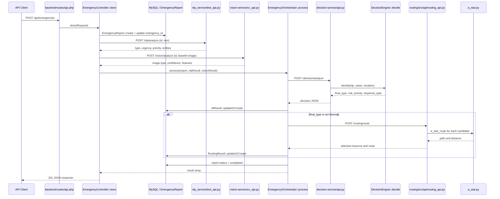
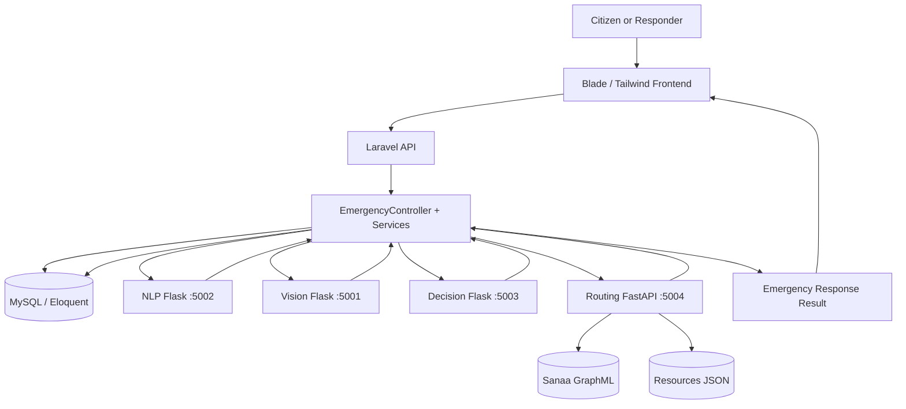

# Multimodal AI Emergency Response System
## Complete Project Analysis & Viva Preparation

---

> **Document status:** Complete analysis of the repository as inspected on 2026-09-07.
>
> **Important accuracy rule:** This document distinguishes implemented code from planned or placeholder documentation. The repository contains a working prototype across several services, but it is not yet a production-ready emergency dispatch platform.

# CODE-LEVEL END-TO-END ANALYSIS

## 0. How to Read This Trace

هذا القسم يضيف تحليلًا على مستوى الكود فوق التحليل المعماري الموجود أدناه. كل انتقال يذكر:

- الملف المسؤول، والـClass والـMethod.
- الكود الذي يسبب الانتقال.
- المستدعي السابق والمستدعى التالي.
- البيانات الداخلة والخارجة.
- ما يحدث بعد عودة النتيجة.

### ملاحظة حاسمة عن السيناريو الحالي

يوجد في المشروع **مساران مختلفان** لإنشاء البلاغ:

1. **مسار واجهة المواطن الحالي:** `create.blade.php` يرسل HTML form إلى `CitizenReportController::store()`. هذا المسار يحفظ سجلًا محليًا ثم يعيد التوجيه، ولا يستدعي `POST /api/emergencies` ولا خدمات NLP/Vision/Decision/Routing.
2. **مسار التكامل الكامل عبر API:** `POST /api/emergencies` يصل إلى `EmergencyController::store()`. هذا هو المسار الذي ينفذ التحقق، ويحفظ التقرير، ويستدعي NLP وVision ثم Decision ثم Routing.

لذلك لا يصح وصف المسار الأول بأنه يمر فعليًا عبر الذكاء الاصطناعي. الـtrace التالي يشرح المسارين ويحدد موضع الفجوة بينهما.

## 1. File-to-File Trace: Citizen Web Form (Current UI Path)

### 1.1 فتح صفحة إنشاء البلاغ

**Caller:** متصفح المواطن.

**File A:** `backend/routes/web.php`، route `GET /reports/create`.

```php
Route::get('/reports/create', [CitizenReportController::class, 'create'])
  ->name('citizen.reports.create');
```

**Calls:** `backend/app/Http/Controllers/Citizen/CitizenReportController.php`، `CitizenReportController::create()`.

```php
public function create()
{
  return view('citizen.reports.create');
}
```

**Input:** لا يوجد body؛ يوجد فقط HTTP GET.

**Output:** Laravel يحمّل Blade view باسم `citizen.reports.create`، أي الملف [create.blade.php](../backend/resources/views/citizen/reports/create.blade.php).

### 1.2 Blade يبني HTML Form

**File:** `backend/resources/views/citizen/reports/create.blade.php`.

```blade
<form id="emergency-report-form"
    action="{{ route('citizen.reports.store') }}"
    method="POST"
    enctype="multipart/form-data">
  @csrf
```

الحقول التي ينتجها النموذج:

- `description`: وصف نصي، required.
- `image`: ملف صورة اختياري، `multipart/form-data`.
- `latitude`: قيمة افتراضية أو قيمة يملؤها المتصفح.
- `longitude`: قيمة افتراضية أو قيمة يملؤها المتصفح.
- `_token`: CSRF token.

زر الإرسال لا يستدعي endpoint JavaScript؛ هو submit عادي للنموذج إلى route اسمه `citizen.reports.store`.

### 1.3 JavaScript يجهز القيم ولا يرسل HTTP بنفسه

**File A:** `backend/resources/js/app.js`، `initGeolocation()`.

```javascript
navigator.geolocation.getCurrentPosition(
  (position) => {
    latInput.value = position.coords.latitude.toFixed(6);
    lngInput.value = position.coords.longitude.toFixed(6);
  },
  (error) => { /* update UI status */ },
  { enableHighAccuracy: true, timeout: 10000, maximumAge: 0 }
);
```

**What it sends to the next step:** لا يرسل request. يغير فقط `#latitude` و`#longitude` في DOM.

**File A:** `app.js`، `initImageUploader()`.

```javascript
fileInput.addEventListener('change', () => {
  if (fileInput.files && fileInput.files[0]) {
    handleFileSelect(fileInput.files[0]);
  }
});
```

`handleFileSelect()` يعرض الصورة باستخدام `FileReader` فقط. لا يحول الصورة إلى Base64 ولا يستدعي Vision API.

**File A:** `app.js`، `initReportSubmissionState()`.

```javascript
form.addEventListener('submit', () => {
  submitBtn.disabled = true;
  loadingOverlay.classList.remove('hidden');
});
```

هذا handler يعطل الزر ويعرض loading overlay، لكنه لا يستخدم `fetch` أو `axios` ولا يمنع submit الطبيعي.

### 1.4 Route يستقبل POST من النموذج

**File A:** `backend/routes/web.php`.

```php
Route::post('/reports', [CitizenReportController::class, 'store'])
  ->name('citizen.reports.store');
```

**Calls:** `CitizenReportController::store(Request $request)`.

**Request data:** form fields، وليس JSON:

```text
description: string
image: uploaded file or null
latitude: numeric
longitude: numeric
_token: CSRF token
```

### 1.5 CitizenReportController يتحقق ويحفظ مباشرة

**File:** `backend/app/Http/Controllers/Citizen/CitizenReportController.php`، method `store()`.

```php
$validated = $request->validate([
  'description' => ['required', 'string', 'min:5'],
  'image' => ['nullable', 'image', 'max:10240'],
  'latitude' => ['required', 'numeric'],
  'longitude' => ['required', 'numeric'],
]);
```

**Next call:** عند وجود صورة، يستدعي Laravel UploadedFile:

```php
$imagePath = $request->file('image')->store('reports', 'public');
```

المستقبل هو filesystem public، والنتيجة `imagePath` مثل `reports/...` أو `null` إذا فشل التخزين.

ثم ينشئ السجل:

```php
$report = EmergencyReport::create([
  'description' => $validated['description'],
  'image' => $imagePath,
  'latitude' => $validated['latitude'],
  'longitude' => $validated['longitude'],
  'status' => 'pending',
]);
```

**Calls:** `backend/app/Models/EmergencyReport.php`، Eloquent static method `create()`.

**Database effect:** INSERT مباشر في جدول `emergency_reports`، غالبًا مع `emergency_id` null لأن هذا المسار لا يضعه.

**Important:** لا يوجد في هذا method استدعاء لـ:

- `NlpService::analyze()`.
- `VisionService::analyze()`.
- `EmergencyOrchestrator::process()`.
- `POST /api/emergencies`.

### 1.6 بعد الحفظ: redirect إلى شاشة التأكيد

```php
return redirect()->route('citizen.reports.submitted', ['id' => $reportId]);
```

**Calls:** `CitizenReportController::submitted($id)` عبر route:

```php
Route::get('/reports/{id}/submitted', [CitizenReportController::class, 'submitted'])
  ->name('citizen.reports.submitted');
```

ثم:

```php
$report = $this->demoService->findReport($id);

return view('citizen.reports.submitted', [
  'report' => $report,
  'reportId' => $id,
  'submissionTime' => Carbon::now()->format('M d, Y - H:i'),
]);
```

**Calls:** `EmergencyDemoService::findReport($id)` ثم Blade `citizen.reports.submitted`.

**Final UI result:** شاشة تأكيد، وليس نتيجة AI أو route حقيقي.

### 1.7 نتيجة هذا المسار

```text
GET /reports/create
  -> web.php route
  -> CitizenReportController::create()
  -> create.blade.php
  -> browser fills location/image preview
  -> POST /reports as multipart form
  -> CitizenReportController::store()
  -> validate()
  -> UploadedFile::store()
  -> EmergencyReport::create()
  -> MySQL INSERT
  -> redirect /reports/{id}/submitted
  -> EmergencyDemoService::findReport()
  -> submitted.blade.php
```

**هذا المسار يتوقف هنا.** لا توجد وصلة فعلية منه إلى سلسلة AI الحالية.

## 2. File-to-File Trace: Full API Integration Path

هذا هو المسار الذي ينفذ فعلًا سلسلة `NLP -> Vision -> Decision -> Routing`. يمكن استدعاؤه من عميل API أو من طبقة مستقبلية تربط واجهة المواطن به.

### 2.1 Route API

**File:** `backend/routes/api.php`.

```php
Route::post('/emergencies', [EmergencyController::class, 'store']);
```

في Laravel يصبح endpoint النهائي:

```text
POST /api/emergencies
```

**Calls:** `App\\Http\\Controllers\\Api\\EmergencyController::store()`.

### 2.2 Controller construction and dependency injection

**File:** `backend/app/Http/Controllers/Api/EmergencyController.php`.

```php
public function __construct(
  private EmergencyOrchestrator $orchestrator,
  private VisionService $visionService,
  private NlpService $nlpService
) {
}
```

Laravel Service Container ينشئ Controller ويحقن:

- `EmergencyOrchestrator`، الذي يحتوي بدوره `DecisionService` و`RoutingService`.
- `VisionService`.
- `NlpService`.

### 2.3 API input validation

**Method:** `EmergencyController::store(Request $request)`.

```php
$validated = $request->validate([
  'text' => 'nullable|string|min:5',
  'image' => 'nullable|string',
  'location.latitude' => 'required|numeric',
  'location.longitude' => 'required|numeric',
]);
```

**Input contract:**

```json
{
  "text": "There is a fire near the road",
  "image": "base64-image-data",
  "location": {
  "latitude": 15.3694,
  "longitude": 44.1910
  }
}
```

بعد التحقق، يمنع Controller طلبًا بلا أي modality:

```php
if (empty($validated['text']) && empty($validated['image'])) {
  return response()->json([
    'success' => false,
    'message' => 'At least text or image is required.',
  ], 422);
}
```

إذا فشل Laravel validation نفسه، يتوقف التنفيذ قبل إنشاء أي report ويعيد Validation response.

### 2.4 إنشاء EmergencyReport ومعرف البلاغ

**Calls:** `EmergencyReport::create()`.

```php
$report = EmergencyReport::create([
  'emergency_id' => 'TEMP',
  'description' => $validated['text'] ?? null,
  'image' => $validated['image'] ?? null,
  'latitude' => $validated['location']['latitude'],
  'longitude' => $validated['location']['longitude'],
  'status' => 'processing',
]);
```

الناتج هو Eloquent model مع `id` من قاعدة البيانات. ثم يتم تحديث المعرف:

```php
$report->update([
  'emergency_id' => 'EMG-' . str_pad(
    $report->id, 6, '0', STR_PAD_LEFT
  ),
]);
```

مثال: إذا كان `id = 27` يصبح `emergency_id = EMG-000027`. هذا المعرف يمرر إلى كل خدمة لاحقة.

### 2.5 Controller calls NLP service

**Caller:** `EmergencyController::store()`.

```php
$nlpResult = null;

if (!empty($validated['text'])) {
  $nlpResult = $this->nlpService->analyze(
    $report->emergency_id,
    $validated['text']
  );
}
```

**Called file:** `backend/app/Services/NlpService.php`، `NlpService::analyze(string $emergencyId, string $text)`.

```php
$response = Http::post(
  config('services.ai.nlp_url') . '/nlp/analyze',
  [
    'emergency_id' => $emergencyId,
    'text' => $text,
  ]
);

$response->throw();
return $response->json();
```

**Configuration call chain:**

```text
config('services.ai.nlp_url')
  -> backend/config/services.php
  -> env('NLP_SERVICE_URL')
```

**HTTP request sent:** `POST {NLP_SERVICE_URL}/nlp/analyze` with JSON containing `emergency_id` and `text`.

### 2.6 NLP Flask endpoint and model execution

**Called file:** `nlp_service/text_api.py`.

```python
@app.route("/nlp/analyze", methods=["POST"])
def analyze_text_api():
  data = request.get_json(silent=True)
  emergency_id = data.get("emergency_id")
  text = data.get("text")
  result = analyze_emergency({
    "emergency_id": emergency_id,
    "text": text
  })
  return jsonify(result), 200
```

**Calls:** `nlp_service/predict.py`, `analyze_emergency(request_json)`.

داخل `analyze_emergency()`:

```python
sequence = text_to_sequence(text, max_len=MAX_LEN)
sequence_tensor = torch.tensor([sequence], dtype=torch.long, device=DEVICE)
type_logits, priority_logits, text_embedding = model(sequence_tensor)
```

ثم يستخرج:

```python
detected_type = ID_TO_TYPE[int(np.argmax(type_probs))]
top_priority = max(priority_probabilities, key=priority_probabilities.get)
```

ويعيد:

```json
{
  "emergency_id": "EMG-000027",
  "text_urgency": 85,
  "emergency_type": "Fire",
  "priority": "critical",
  "priority_probabilities": {},
  "text_embedding": [],
  "entities": []
}
```

**Return path:** Flask JSON -> Laravel `Response` -> `NlpService::analyze()` returns PHP array -> `EmergencyController` stores it in `$nlpResult`.

### 2.7 Controller calls Vision service

إذا كان `image` موجودًا:

```php
$visionResult = $this->visionService->analyze(
  $report->emergency_id,
  $validated['image']
);
```

**Called file:** `backend/app/Services/VisionService.php`، method `analyze()`.

```php
$response = Http::post(
  config('services.ai.vision_url') . '/vision/analyze',
  [
    'emergency_id' => $emergencyId,
    'image' => $imageBase64,
  ]
);

$response->throw();
$result = $response->json();
```

Vision result is normalized before returning:

```php
$imageType = match ($imageType) {
  'Traffic Accident' => 'Traffic_Accident',
  'No Emergency' => 'Normal',
  default => $imageType,
};
```

ثم Controller يختزل النتيجة إلى عقد Decision فقط:

```php
$visionResult = [
  'image_type' => $visionResult['image_type'] ?? null,
  'confidence' => $visionResult['confidence'] ?? null,
];
```

### 2.8 Vision Flask endpoint and model execution

**Called file:** `vision-service/cv_api.py`، `predict_image_api()`.

```python
data = request.get_json(silent=True)
image_base64 = data.get("image")

if "," in image_base64:
  image_base64 = image_base64.split(",", 1)[1]

image_data = base64.b64decode(image_base64)
with open(image_path, "wb") as file:
  file.write(image_data)

result = predict_image(image_path=image_path)
result["emergency_id"] = emergency_id
```

**Calls:** `vision-service/predict.py`, `predict_image(image_path)`.

```python
image_tensor = preprocess_image(image_path)
predictions = model.predict(image_tensor, verbose=0)
probabilities = predictions[0]
embedding = predictions[1]
predicted_index = int(np.argmax(probabilities[0]))
```

الناتج الأصلي يحتوي `emergency_type`, `confidence`, `class_probabilities`, و`image_features`. بعده يعود إلى Laravel، حيث يصبح `$visionResult` متوافقًا مع Decision contract.

### 2.9 Controller calls Orchestrator

بعد انتهاء modality calls:

```php
$result = $this->orchestrator->process(
  $report,
  $nlpResult,
  $visionResult
);
```

**Called file:** `backend/app/Services/EmergencyOrchestrator.php`، method `process(EmergencyReport $report, ?array $nlpResult, ?array $visionResult)`.

أولًا يبني الموقع من model:

```php
$location = [
  'latitude' => (float) $report->latitude,
  'longitude' => (float) $report->longitude,
];
```

ثم يستدعي Decision، وليس Routing مباشرة:

```php
$decisionResult = $this->decisionService->analyze(
  $report->emergency_id,
  $nlpResult,
  $visionResult,
  $location
);
```

### 2.10 DecisionService -> Decision Flask API

**File:** `backend/app/Services/DecisionService.php`.

```php
$response = Http::post(
  config('services.ai.decision_url') . '/decision/analyze',
  [
    'emergency_id' => $emergencyId,
    'nlp' => $nlp,
    'vision' => $vision,
    'location' => $location,
  ]
);

$response->throw();
return $response->json();
```

**Data sent:** نفس `emergency_id`، ونتيجة NLP إن وجدت، ونتيجة Vision المختزلة إن وجدت، والموقع.

**Called file:** `decision-service/api.py`، `analyze()`.

```python
result = engine.decide(
  emergency_id=emergency_id,
  nlp=nlp,
  vision=vision,
  location=location,
)
return jsonify(result.to_dict()), 200
```

**Calls:** `decision-service/decision_engine.py`, `DecisionEngine.decide()`.

### 2.11 DecisionEngine computes the final decision

**Validation and object construction:**

```python
nlp_obj = NLPResult(**nlp) if nlp else None
vision_obj = VisionResult(**vision) if vision else None

if nlp_obj is None and vision_obj is None:
  raise ValueError("يجب توفر نتيجة NLP أو Vision على الأقل")
```

**Branch selection:**

```python
if nlp_obj and vision_obj:
  final_type, risk_score, confidence = self._fuse_both(nlp_obj, vision_obj)
elif nlp_obj:
  final_type, risk_score, confidence = self._from_nlp_only(nlp_obj)
else:
  final_type, risk_score, confidence = self._from_vision_only(vision_obj)
```

**Fusion branch:** agreement uses 50/50; conflict uses 45% text and 55% vision. Then:

```python
risk_score, priority = self._apply_priority(final_type, risk_score)
response_type = RESPONSE_TYPE_MAP[final_type]
```

**Returned data:** `DecisionResult.to_dict()` returns `emergency_id`, `final_type`, `response_type`, `risk_score`, `priority`, `confidence`, and `location`.

### 2.12 Orchestrator persists AiResult

عند عودة Decision إلى Laravel:

```php
$aiResult = AiResult::updateOrCreate(
  ['emergency_report_id' => $report->id],
  [
    'text_urgency' => $nlpResult['text_urgency'] ?? null,
    'emergency_type' => $nlpResult['emergency_type'] ?? null,
    'image_type' => $visionResult['image_type'] ?? null,
    'final_type' => $decisionResult['final_type'] ?? null,
    'response_type' => $decisionResult['response_type'] ?? null,
    'risk_score' => $decisionResult['risk_score'] ?? null,
    'priority' => $decisionResult['priority'] ?? null,
    'confidence' => $decisionResult['confidence'] ?? null,
    'entities' => $nlpResult['entities'] ?? null,
  ]
);
```

**Calls:** `backend/app/Models/AiResult.php` through Eloquent `updateOrCreate()`.

**Database effect:** upsert-like behavior keyed by `emergency_report_id`; stores modality outputs and final decision in `ai_results`.

### 2.13 Normal branch ends before Routing

```php
if (($decisionResult['final_type'] ?? null) === 'Normal') {
  $report->update(['status' => 'completed']);

  return [
    'emergency_id' => $report->emergency_id,
    'status' => 'completed',
    'decision' => $decisionResult,
    'routing' => null,
  ];
}
```

**Result:** لا يتم استدعاء `RoutingService` إذا كان القرار `Normal`.

### 2.14 Emergency branch calls RoutingService

لأي `final_type` غير `Normal`:

```php
$routingResult = $this->routingService->analyze(
  $report->emergency_id,
  $decisionResult['response_type'],
  $location
);
```

**Called file:** `backend/app/Services/RoutingService.php`، method `analyze()`.

```php
$response = Http::post(
  config('services.ai.routing_url') . '/routing/route',
  [
    'emergency_id' => $emergencyId,
    'response_type' => $responseType,
    'location' => [
      'latitude' => $location['latitude'],
      'longitude' => $location['longitude'],
    ],
  ]
);

$response->throw();
return $response->json();
```

### 2.15 Routing API finds and selects a resource

**Called file:** `routing/src/api/routing_api.py`, `analyze_routing(request)`.

```python
emergency_node = ox.distance.nearest_nodes(
  graph,
  X=request.location.longitude,
  Y=request.location.latitude
)

result = select_best_resource(
  graph,
  resources,
  emergency_node,
  request.response_type
)
```

**Calls:** `routing/src/resource_selection/select_resource.py`, `select_best_resource()`.

```python
candidates = get_resources_by_type(resources, response_type)

for resource in candidates:
  target_node = int(resource.get("node_id"))
  path, distance_km, estimated_time_minutes, execution_time, explored_nodes = \
    a_star_route(graph, start_node, target_node)
```

**Calls next:** `routing/src/routing/a_star.py`, `a_star_route()`.

The algorithm reads edge lengths through `get_edge_length()`, uses Haversine `heuristic()`, maintains a heap priority queue, reconstructs `previous` nodes, and returns the shortest successful path. `select_best_resource()` compares `distance_km` and keeps the smallest route.

### 2.16 Routing API builds the response

بعد اختيار المورد، يحول `routing_api.py` كل node إلى coordinates:

```python
for node in result["path"]:
  route_coordinates.append({
    "latitude": float(graph.nodes[node]["y"]),
    "longitude": float(graph.nodes[node]["x"])
  })
```

ثم يعيد:

```json
{
  "emergency_id": "EMG-000027",
  "resource_available": true,
  "resource": {
  "id": "R-1",
  "name": "Ambulance 1",
  "type": "Ambulance",
  "latitude": 15.37,
  "longitude": 44.19
  },
  "route": [{"latitude": 15.37, "longitude": 44.19}],
  "distance_km": 4.2,
  "estimated_time_minutes": 8.4
}
```

### 2.17 Orchestrator persists RoutingResult and completes report

**File:** `EmergencyOrchestrator.php`.

```php
RoutingResult::updateOrCreate(
  ['emergency_report_id' => $report->id],
  [
    'resource_available' => $routingResult['resource_available'] ?? false,
    'resource_id' => $routingResult['resource']['id'] ?? null,
    'resource_type' => $routingResult['resource']['type'] ?? null,
    'resource_name' => $routingResult['resource']['name'] ?? null,
    'route' => $routingResult['route'] ?? null,
    'distance_km' => $routingResult['distance_km'] ?? null,
    'estimated_time_minutes' => $routingResult['estimated_time_minutes'] ?? null,
  ]
);

$report->update(['status' => 'completed']);
```

**Database effects:** upsert into `routing_results`, then update `emergency_reports.status` from `processing` to `completed`.

### 2.18 Final API response returns to caller

`EmergencyOrchestrator::process()` returns:

```php
return [
  'emergency_id' => $report->emergency_id,
  'status' => 'completed',
  'decision' => $decisionResult,
  'routing' => $routingResult,
];
```

ثم `EmergencyController::store()` يغلفه:

```php
return response()->json([
  'success' => true,
  'data' => $result,
], 201);
```

**Final path:** Python response -> Laravel service array -> Eloquent persistence -> Controller JSON response -> API client.

## 3. Complete API Trace in One Diagram



## 4. Data Contract at Each Boundary

| Boundary | Sender | Receiver | Data sent | Data returned |
|---|---|---|---|---|
| Web form | `create.blade.php` | `CitizenReportController::store()` | multipart description/image/coordinates/CSRF | redirect response |
| API route | API client | `EmergencyController::store()` | JSON text/image/location | 201 `{success,data}` |
| NLP | `NlpService` | `text_api.py` | emergency ID + text | urgency/type/priority/entities |
| Vision | `VisionService` | `cv_api.py` | emergency ID + Base64 image | type/confidence/probabilities/features |
| Decision | `DecisionService` | `decision-service/api.py` | ID + NLP + Vision + location | final type/risk/priority/response |
| Routing | `RoutingService` | `routing_api.py` | ID + response type + location | resource/path/distance/time |
| Persistence | Orchestrator | Eloquent models | normalized AI/routing fields | database rows |

## 5. Failure and Short-Circuit Points

- فشل validation في `EmergencyController::store()` يوقف المسار قبل DB.
- غياب كل من `text` و`image` يعيد HTTP 422.
- `NlpService`, `VisionService`, `DecisionService`, و`RoutingService` تستعمل `$response->throw()`؛ أي HTTP failure يرمي exception ويوقف التنفيذ.
- NLP أو Vision يعيدان أخطاء HTTP عند JSON غير صالح أو input ناقص.
- Decision يرفض غياب modality، أو نوع طوارئ غير معروف، أو قيم confidence خارج النطاق.
- Routing قد يعيد `resource_available: false` إذا لم يوجد مورد أو route ناجح.
- لا توجد transaction حول التقرير ونتائج AI والتوجيه؛ لذلك قد يبقى report بحالة `processing` إذا فشلت خدمة بعد `EmergencyReport::create()`.
- مسار واجهة المواطن يلتقط بعض exceptions في التخزين و`EmergencyReport::create()` ويستمر باستخدام fallback ID، لذلك قد تعرض الواجهة تأكيدًا دون سجل قاعدة بيانات مكتمل.

## 6. Code-Level Conclusion

التنفيذ الفعلي الحالي ليس خطًا واحدًا من Blade إلى AI. توجد واجهة مواطن تحفظ البلاغ مباشرة عبر `CitizenReportController::store()`، وتوجد سلسلة تكامل كاملة مستقلة تبدأ من `POST /api/emergencies`. لكي تصبح تجربة المواطن end-to-end فعلية، يجب أن يستدعي مسار `CitizenReportController::store()` نفس orchestration الموجود في `EmergencyController::store()`، أو أن يرسل النموذج إلى API بدل إنشاء سجل مستقل. هذه هي أهم نتيجة يكشفها تتبع الكود، ولا تظهر من مخطط Architecture وحده.

# 1. Project Overview

## 1.1 هدف المشروع

يهدف المشروع إلى بناء نظام استجابة للطوارئ متعدد الوسائط. يستقبل النظام بلاغ المواطن من خلال وصف نصي، أو صورة، أو الاثنين معًا، مع الموقع الجغرافي للحادث. بعد ذلك يحلل النظام المدخلات بواسطة خدمات ذكاء اصطناعي، يدمج النتائج في قرار واحد، ثم يختار أقرب مورد استجابة مناسب ويحسب مسار الوصول إليه.

الهدف العملي هو تقليل زمن فرز البلاغات ومساعدة فرق الاستجابة على معرفة:

- نوع الطارئ المحتمل.
- درجة الخطورة والأولوية.
- نوع الاستجابة المطلوب.
- المورد أو الفريق الأقرب.
- المسار الجغرافي التقديري للوصول.

## 1.2 المشكلة التي يحلها

البلاغات الواقعية قد تصل بصيغ مختلفة وغير منظمة. قد يكتب المستخدم وصفًا مختصرًا، أو يرفع صورة، أو يقدم النوعين معًا. الاعتماد على مصدر واحد قد يؤدي إلى تصنيف ناقص أو غير دقيق. لذلك يستخدم المشروع:

1. تحليل النص لاستخراج نوع الطارئ ودرجة الإلحاح.
2. تحليل الصورة للتعرف على مشاهد مثل الحريق أو الفيضان أو الحادث.
3. دمج النتيجتين في محرك قرار واحد.
4. اختيار مورد مناسب على شبكة طرق جغرافية.

المشكلة التي يعالجها المشروع هي تحويل البلاغ الخام إلى قرار قابل للتنفيذ. لكنه لا يزال نموذجًا أوليًا؛ فلا توجد حتى الآن حركة مرور لحظية، أو إدارة تشغيلية كاملة للموارد، أو نظام صلاحيات إنتاجي مكتمل.

## 1.3 المستخدمون

- **المواطن:** يرسل البلاغ، الوصف، الصورة، والموقع، ويتابع حالة البلاغ.
- **المستجيب أو المشرف:** يراجع البلاغات، يرى تفاصيل الطوارئ، يتابع الخريطة، ويغير حالة البلاغ عبر واجهة العرض الحالية.
- **خدمات الذكاء الاصطناعي:** تستقبل مدخلات محددة وتعيد نتائج تحليل منظمة.
- **النظام الخلفي:** ينسق الخدمات ويحفظ النتائج في قاعدة البيانات.

## 1.4 المكونات الرئيسية

| المكون | الوظيفة | الحالة الفعلية |
|---|---|---|
| Laravel Backend | API، صفحات الويب، التنسيق، حفظ البيانات | منفذ جزئيًا |
| MySQL | حفظ البلاغات ونتائج AI والتوجيه | منفذ عبر migrations |
| NLP Service | تحليل النص وتصنيف الطوارئ والأولوية | منفذ كخدمة Flask |
| Vision Service | تصنيف الصور واستخراج نتيجة بصرية | منفذ كخدمة Flask |
| Decision Service | دمج NLP وVision وحساب الخطر | منفذ كخدمة Flask واختبارات وحدات |
| Routing Service | اختيار المورد وحساب الطريق | منفذ كخدمة FastAPI |
| Blade/Tailwind Frontend | نماذج المواطن ولوحات العرض | منفذ كنموذج أولي |
| Authentication | جلسات Laravel وبعض صفحات الدخول | غير مكتمل |

## 1.5 التقنيات المستخدمة

- **Backend:** PHP 8.2+، Laravel 12، Eloquent ORM.
- **Database:** MySQL عبر XAMPP، مع Laravel migrations.
- **Frontend:** Blade، Tailwind CSS 4، Vite، Axios، JavaScript.
- **NLP:** Python، Flask، PyTorch، NumPy، نموذج BiLSTM ثنائي الاتجاه مع Attention.
- **Vision:** Python، Flask، TensorFlow/Keras، Pillow، NumPy.
- **Decision:** Python، Flask، dataclasses، قواعد دمج حتمية.
- **Routing:** Python، FastAPI، Pydantic، OSMnx، NetworkX، GraphML، خوارزميتا A* وDijkstra.
- **Testing:** PHPUnit/Laravel tests، unittest لمحرك القرار، واختبار نصي لخدمة التوجيه.
- **Infrastructure المحلي:** XAMPP، Apache، MySQL، وخدمات Python منفصلة.

## 1.6 حدود التحليل

الوثائق القديمة في المشروع ما زالت تحتوي على `TBD` وتصف مرحلة قاعدة البيانات فقط، بينما الكود الحالي أوسع من ذلك. لذلك يعتمد هذا الملف على الكود الموجود أولًا، ويشير صراحة إلى التناقضات بدل اعتبار الوثائق القديمة مصدرًا نهائيًا.

# 2. Complete Project Structure

## 2.1 Tree المشروع

> تم تضمين ملفات ومجلدات المصدر والاختبارات والوثائق والموارد المهمة. مجلدات الاعتماديات والمخرجات المولدة الكبيرة مذكورة في الأسفل بدل نسخ كل ملف داخلي فيها.

```text
Multimodal_AI_Emergency_Response_System/
├── README.md
├── CHANGELOG.md
├── docs/
│   ├── PROJECT_COMPLETE_ANALYSIS.md
│   ├── api.md
│   ├── architecture.md
│   ├── backend-requirements.md
│   ├── database.md
│   ├── decisions.md
│   ├── integration-dependencies.md
│   ├── project-scope.md
│   ├── roadmap.md
│   ├── s5-scope.md
│   └── security.md
├── backend/
│   ├── artisan
│   ├── composer.json
│   ├── package.json
│   ├── phpunit.xml
│   ├── README.md
│   ├── app/
│   │   ├── Http/
│   │   │   ├── Controllers/
│   │   │   │   ├── Api/EmergencyController.php
│   │   │   │   ├── Auth/
│   │   │   │   ├── Citizen/
│   │   │   │   └── Responder/
│   │   │   └── Middleware/
│   │   ├── Models/
│   │   │   ├── AiResult.php
│   │   │   ├── EmergencyReport.php
│   │   │   ├── RoutingResult.php
│   │   │   └── User.php
│   │   ├── Providers/
│   │   └── Services/
│   │       ├── DecisionService.php
│   │       ├── EmergencyDemoService.php
│   │       ├── EmergencyOrchestrator.php
│   │       ├── NlpService.php
│   │       ├── RoutingService.php
│   │       └── VisionService.php
│   ├── bootstrap/
│   │   ├── app.php
│   │   ├── cache/
│   │   └── providers.php
│   ├── config/
│   │   ├── app.php
│   │   ├── auth.php
│   │   ├── cache.php
│   │   ├── database.php
│   │   ├── filesystems.php
│   │   ├── logging.php
│   │   ├── mail.php
│   │   ├── queue.php
│   │   ├── sanctum.php
│   │   └── services.php
│   ├── database/
│   │   ├── factories/
│   │   ├── migrations/
│   │   │   ├── 0001_01_01_000000_create_users_table.php
│   │   │   ├── 0001_01_01_000001_create_cache_table.php
│   │   │   ├── 0001_01_01_000002_create_jobs_table.php
│   │   │   ├── *_create_emergency_reports_table.php
│   │   │   ├── *_create_ai_results_table.php
│   │   │   └── *_create_routing_results_table.php
│   │   └── seeders/
│   │       └── DatabaseSeeder.php
│   ├── public/
│   │   ├── index.php
│   │   ├── robots.txt
│   │   └── build/
│   ├── resources/
│   │   ├── css/app.css
│   │   ├── js/app.js
│   │   └── views/
│   │       ├── auth/
│   │       ├── citizen/
│   │       ├── layouts/
│   │       ├── pages/
│   │       └── responder/
│   ├── routes/
│   │   ├── api.php
│   │   ├── console.php
│   │   └── web.php
│   ├── storage/
│   │   ├── app/
│   │   ├── framework/
│   │   └── logs/
│   └── tests/
│       ├── TestCase.php
│       ├── Feature/
│       │   ├── EmergencyReportTest.php
│       │   ├── FrontendRoutesTest.php
│       │   └── ExampleTest.php
│       └── Unit/ExampleTest.php
├── decision-service/
│   ├── api.py
│   ├── decision_engine.py
│   ├── requirements.txt
│   ├── curl_examples.sh
│   ├── README.md
│   └── test_decision_engine.py
├── nlp_service/
│   ├── predict.py
│   ├── text_api.py
│   ├── HumAID_priority_training_ready_planB.csv
│   ├── S1_DistilBERT_Local_Model_FINAL.ipynb
│   └── s1_emergency_bilstm_model0.2.pt
├── vision-service/
│   ├── cv_api.py
│   ├── predict.py
│   ├── train.py
│   ├── README.md
│   ├── models/image_model.keras
│   ├── outputs/class_names.json
│   └── temp/
└── routing/
    ├── cache/*.json
    ├── data/
    │   ├── emergencies/
    │   ├── maps/sanaa_drive.graphml
    │   └── resources/
    │       ├── resources.json
    │       └── resources_with_nodes.json
    ├── src/
    │   ├── api/routing_api.py
    │   ├── graph/
    │   │   ├── osm_graph.py
    │   │   └── node_mapping.py
    │   ├── map/
    │   ├── resource_selection/
    │   │   ├── resource_loader.py
    │   │   └── select_resource.py
    │   └── routing/
    │       ├── a_star.py
    │       └── dijkstra.py
    ├── tests/
    │   ├── main.py
    │   ├── requirements.txt
    │   └── test_routing_system.py
    └── cache/
```

### الاعتماديات والمخرجات المستبعدة من التفصيل

- `backend/vendor/`: مكتبات Composer المثبتة، وليست كود المشروع الأساسي.
- `backend/node_modules/` إن وجدت: مكتبات JavaScript المثبتة.
- `backend/storage/framework/` و`backend/public/build/`: ملفات تشغيل أو build مولدة.
- `routing/cache/`: نتائج تخزين مؤقت مولدة.
- ملفات النماذج الكبيرة مثل `.pt` و`.keras` وGraphML: موارد تشغيلية، وليست ملفات مصدر نصية.

## 2.2 وظيفة المجلدات المهمة

| المجلد | الوظيفة |
|---|---|
| `backend/app` | منطق Laravel: Controllers، Models، Services، وProviders. |
| `backend/routes` | تعريف مسارات الويب وAPI. |
| `backend/database` | migrations، factories، seeders وبنية قاعدة البيانات. |
| `backend/resources` | واجهة Blade وCSS وJavaScript. |
| `backend/tests` | اختبارات Laravel الوظيفية والوحدات. |
| `decision-service` | خدمة الدمج والقرار المستقلة. |
| `nlp_service` | خدمة تحليل النص والنموذج المدرب. |
| `vision-service` | خدمة تصنيف الصور والنموذج المدرب. |
| `routing/src` | خدمة الخرائط، تحميل الرسم البياني، اختيار المورد، وحساب المسار. |
| `routing/data` | شبكة طرق صنعاء وبيانات الموارد. |
| `docs` | وثائق المتطلبات والقرارات والتحليل الحالي. |

# 3. System Architecture

## 3.1 النظرة المعمارية

النظام مقسم إلى Laravel باعتباره نقطة الدخول والمنسق، وخدمات Python متخصصة لكل مرحلة AI أو Routing. قاعدة البيانات لا تحفظ البلاغ فقط، بل تحفظ أيضًا نتيجة الدمج ونتيجة التوجيه المرتبطة به.



## 3.2 تدفق البلاغ الفعلي

1. يرسل العميل `POST /api/emergencies` مع `text` أو `image` وموقع `latitude/longitude`.
2. يتحقق `EmergencyController` من البيانات.
3. ينشئ Laravel سجل `EmergencyReport` بحالة أولية.
4. ينشئ معرفًا بصيغة مثل `EMG-000001`.
5. يستدعي NLP إذا كان النص موجودًا.
6. يستدعي Vision إذا كانت الصورة موجودة.
7. يستدعي `DecisionService` بالنتائج المتاحة والموقع.
8. يحفظ `AiResult` مع النوع النهائي، الخطر، الأولوية، الثقة، والكيانات.
9. إذا كان النوع النهائي `Normal` ينهي البلاغ دون Routing.
10. إذا كان البلاغ طارئًا، يستدعي `RoutingService` بنوع الاستجابة والموقع.
11. يحفظ `RoutingResult`، بما في ذلك المورد والطريق والمسافة والزمن التقديري.
12. يغير حالة التقرير إلى `completed` ويعيد النتيجة للعميل.

## 3.3 واجهات الخدمات

| الخدمة | المنفذ الافتراضي | الواجهات |
|---|---:|---|
| Vision | 5001 | `GET /health`، `POST /vision/analyze` |
| NLP | 5002 | `GET /health`، `POST /nlp/analyze` |
| Decision | 5003 | `GET /health`، `POST /decision/analyze` |
| Routing | 5004 | `GET /health`، `POST /routing/route` |
| Laravel | حسب Apache أو `php artisan serve` | `POST /api/emergencies` ومسارات الويب |

## 3.4 حالة التنفيذ مقابل الخطة

### منفذ

- نموذج بلاغ وقاعدة بيانات Laravel.
- تنسيق بين Laravel وDecision وRouting، مع خدمات NLP/Vision منفصلة.
- تخزين نتائج AI والتوجيه.
- محرك دمج حتمي ومختبر.
- حساب مسار A* واختيار أقرب مورد.
- واجهات Blade أولية للمواطن والمستجيب.

### غير مكتمل أو مخطط

- API authentication وصلاحيات المواطن والمستجيب.
- ربط المستخدم بالبلاغ ownership.
- بث حي أو تحديث لحظي للبلاغات.
- حركة مرور حية وإغلاقات الطرق.
- إدارة حالة توفر الموارد بشكل تشغيلي.
- معاملات rollback شاملة عند فشل خدمة خارجية.
- اختبارات end-to-end لجميع الخدمات.
- توثيق نهائي موحد لجميع الإعدادات والاعتماديات.

# 4. Backend and API Analysis

## 4.1 Laravel Backend

Laravel هو نقطة التكامل الرئيسية. يستخدم Eloquent للبيانات، Blade للواجهة، وServices لتغليف استدعاءات الخدمات الخارجية. أهم طبقة هي `EmergencyOrchestrator`, التي تنفذ قرارًا وتسجيلاً وتوجيهًا بالترتيب.

### المسارات الرئيسية

- `POST /api/emergencies`: إنشاء ومعالجة بلاغ.
- `GET /api/test-routing`: مسار تجريبي.
- `GET /api/test-orchestrator`: مسار تجريبي.

مسارات الويب تشمل الصفحات العامة، تسجيل الدخول والتسجيل، صفحات المواطن، وصفحات المستجيب. وجود المسار لا يعني أن الحماية أو المنطق التشغيلي مكتملان.

## 4.2 شكل طلب البلاغ

```json
{
  "text": "There is a major fire near the road",
  "image": "data:image/jpeg;base64,...",
  "location": {
    "latitude": 15.3694,
    "longitude": 44.191
  }
}
```

`text` و`image` اختياريان منفردًا، لكن يجب وجود واحد منهما على الأقل. الموقع مطلوب. التحقق الحالي يتأكد من النوع وبعض القيود النصية، لكنه لا يفرض نطاق latitude/longitude في Laravel ولا يتحقق بشكل قوي من حجم الصورة أو نوعها.

## 4.3 شكل النتيجة

النتيجة العامة تحتوي عادة على:

- `emergency_id`.
- `status`.
- `decision`: النوع النهائي، نوع الاستجابة، risk score، priority، confidence، والموقع.
- `routing`: المورد والمسار والمسافة والزمن أو `null` للحالة `Normal`.

## 4.4 تخزين الملفات والصور

خدمة Vision تستقبل Base64 وتكتب صورة مؤقتة ثم تحذفها في `finally`. هذا يمنع بقاء الملف المؤقت في الحالة الطبيعية، لكنه لا يغني عن التحقق من MIME، الحجم، الامتداد، ورفض payloads الضخمة.

# 5. Database and Domain Model

## 5.1 الجداول

- `users`, `password_reset_tokens`, `sessions`.
- `cache`, `cache_locks`.
- `jobs`, `job_batches`, `failed_jobs`.
- `personal_access_tokens` عبر Sanctum.
- `emergency_reports`.
- `ai_results`.
- `routing_results`.

## 5.2 EmergencyReport

يحفظ:

- `emergency_id`.
- `description`.
- `image`.
- `latitude` و`longitude`.
- `status`.
- timestamps.

ويرتبط بعلاقة واحدة مع `AiResult` وعلاقة واحدة مع `RoutingResult`.

## 5.3 AiResult

يحفظ:

- إلحاح النص `text_urgency`.
- نوع النص `emergency_type`.
- نوع الصورة `image_type`.
- النوع النهائي `final_type`.
- نوع الاستجابة `response_type`.
- `risk_score`.
- `priority`.
- `confidence`.
- `entities` المستخرجة من النص.

## 5.4 RoutingResult

يحفظ:

- هل يوجد مورد.
- معرف المورد ونوعه واسمه.
- إحداثيات المورد.
- قائمة إحداثيات الطريق.
- المسافة بالكيلومتر.
- الزمن التقديري بالدقائق.

العلاقات تستخدم foreign keys مع cascade عند حذف البلاغ، ويُفترض وجود نتيجة واحدة لكل بلاغ عبر unique constraint.

## 5.5 ملاحظات تصميمية

- لا يوجد ربط واضح بين `emergency_reports` و`users`، لذلك لا توجد ملكية بلاغ رسمية.
- `status` نصي وليس enum أو state machine.
- لا يوجد audit log لتغييرات الحالة أو قرارات الإرسال.
- لا توجد استراتيجية مكتملة للفهرسة الجغرافية أو الاحتفاظ بالبيانات.
- بعض وثائق قاعدة البيانات القديمة تقول إن الوصف غير nullable، بينما دعم البلاغ الصوري جعل الكود الحالي يسمح بمدخلات متعددة الوسائط.

# 6. AI Services

## 6.1 NLP Service

تستخدم الخدمة Flask وتستمع افتراضيًا على `5002`. تستقبل `emergency_id` و`text` عبر `POST /nlp/analyze`.

النموذج هو PyTorch BiLSTM ثنائي الاتجاه بطبقتين مع Attention ورأسي تصنيف: نوع الطوارئ والأولوية. الحد الأقصى للنص هو 50 token تقريبًا، مع معالجة للكلمات غير المعروفة. كما توجد عملية استخراج كيانات بسيطة تعتمد على regex ومصطلحات موقع أساسية.

الناتج يتضمن عادة:

- `text_urgency` من 0 إلى 100.
- `emergency_type`.
- `priority` واحتمالاتها.
- embedding النص.
- `entities`.

القيود:

- لا يوجد `requirements.txt` خاص بـ NLP.
- لا توجد اختبارات خدمة مستقلة ظاهرة.
- استخراج الكيانات ليس نظام NER كاملًا.
- جودة النموذج مرتبطة ببيانات التدريب والنموذج الموجود، ولا توجد في المشروع الحالي مؤشرات تقييم تشغيلية كافية.

## 6.2 Vision Service

تستخدم Flask وتستمع افتراضيًا على `5001`. تفك Base64، تحفظ JPEG مؤقتًا، تغير الحجم إلى `224x224`، تطبع القيم إلى `[0,1]`، ثم تشغل نموذج Keras الموجود في `models/image_model.keras`.

الفئات الموجودة في `outputs/class_names.json` هي:

- `Earthquake`.
- `Fire`.
- `Flood`.
- `No Emergency`.
- `Traffic Accident`.

تقوم طبقة Laravel بتطبيع بعض التسميات إلى `Traffic_Accident` و`Normal` لتطابق عقد القرار.

القيود الرئيسية:

- لا يوجد حد واضح لحجم الصورة.
- لا يوجد تحقق صريح قوي من MIME أو سلامة Base64.
- الأخطاء تعيد رسالة exception مباشرة في بعض الحالات.
- تحميل النموذج يتم عند import، مما يزيد زمن بدء الخدمة ويزيد الاعتماد على الذاكرة.
- لا توجد suite اختبارات واضحة للخدمة.

## 6.3 Decision/Fusion Service

الخدمة مبنية بـ Flask على المنفذ `5003`. الأنواع المدعومة:

`Fire`, `Flood`, `Earthquake`, `Traffic_Accident`, `Medical_Emergency`, `Other`, `Normal`.

قواعد الدمج:

- عند توافق NLP وVision: وزن 50% لكل مصدر.
- عند التعارض: Vision بوزن 55% وNLP بوزن 45%.
- عند وجود مصدر واحد: تخفيض الثقة بنسبة 30%.
- `Normal` يفرض `risk_score = 0`.
- الأولوية: `critical` من 85، `high` من 60، `medium` من 30، وإلا `low`.
- Fire وEarthquake مع risk score لا يقل عن 75 يحصلان على critical override ودرجة لا تقل عن 90.

خريطة الاستجابة:

| النوع النهائي | نوع الاستجابة |
|---|---|
| Fire | Fire_Rescue |
| Traffic_Accident | Ambulance |
| Medical_Emergency | Ambulance |
| Flood | Rescue_Team |
| Earthquake | Rescue_Team |
| Other | General_Response |
| Normal | No_Response |

الخدمة لديها 11 اختبارًا لوحدة القرار تغطي الاتفاق والتعارض والمصدر الواحد والحالة الطبيعية والتجاوز الحرج والتحقق من المدخلات وتمرير الموقع.

## 6.4 Routing Service

الخدمة مبنية بـ FastAPI وتستمع افتراضيًا على `5004`. تحمل GraphML لشبكة طرق صنعاء وبيانات الموارد عند بدء التشغيل.

تدفقها:

1. التحقق من إحداثيات الموقع بواسطة Pydantic.
2. إيجاد أقرب عقدة طريق باستخدام OSMnx.
3. تصفية الموارد حسب `response_type`.
4. تشغيل A* لكل مورد صالح.
5. تجاهل المسارات الفاشلة.
6. اختيار أقل مسافة.
7. تحويل عقد الطريق إلى latitude/longitude.
8. حساب الزمن على أساس سرعة افتراضية 30 كم/ساعة.

خوارزمية A* تستخدم مسافة Haversine كـ heuristic وأطوال الحواف كتكلفة. توجد Dijkstra للمقارنة والتحقق.

القيود:

- لا توجد حركة مرور حية.
- لا توجد إغلاقات طرق أو أوزان خاصة بالطوارئ.
- الموارد static في JSON ولا يوجد availability تشغيلي موثق.
- GraphML والبيانات تُحمل عند بدء الخدمة.
- ملف متطلبات الخدمة الكاملة غير موحد في جذر routing.
- بعض بيانات الموارد تحتوي قيمًا غير نظيفة مثل `nan`.

# 7. Frontend and User Experience

الواجهة مبنية باستخدام Blade وTailwind وVite، وتضم:

- صفحات عامة.
- نموذج إرسال بلاغ.
- تحديد الموقع من المتصفح.
- اختيار الصورة ومعاينتها.
- صفحات المواطن للبلاغات والتفاصيل والإشعارات والملف الشخصي.
- لوحة المستجيب، قائمة الطوارئ، الخريطة، التحليلات، الإشعارات والإعدادات.

تستخدم نماذج Blade رموز CSRF، لكن وجود الواجهات لا يعني أن كل البيانات المعروضة متصلة ببيانات تشغيل حقيقية. `EmergencyDemoService` يوفر سجلات تجريبية، وبعض تحليلات المستجيب مثل أزمنة الاستجابة، نسب الحل، الثقة، الاتجاهات الشهرية، وتوزيع الفئات hard-coded.

التوصيف الصحيح للواجهة هو **functional prototype/demo interface** وليس مركز قيادة حيًا.

# 8. Security, Reliability, and Risk Analysis

## 8.1 الموجود حاليًا

- Laravel session guard.
- hashing لكلمات المرور عبر Laravel.
- CSRF في نماذج الويب.
- تحقق أساسي من المدخلات.
- Sanctum migration/package موجودان.
- Pydantic يفرض نطاق الإحداثيات في Routing.

## 8.2 الفجوات المهمة

1. مسارات المواطن والمستجيب ليست محمية بشكل شامل بـ `auth` middleware.
2. تسجيل دخول المستجيب لا ينفذ تحققًا حقيقيًا من بيانات الاعتماد.
3. تدفق دخول المواطن يحتاج التحقق من أن الفشل لا يؤدي إلى dashboard.
4. إعادة تعيين كلمة المرور وتحديث الملف الشخصي غير مكتملين أو لا يحفظان فعليًا.
5. لا توجد أدوار أو Policies أو Gates واضحة.
6. `POST /api/emergencies` غير محمي بـ Sanctum.
7. `User` لا يستخدم `HasApiTokens` حسب التحليل الحالي.
8. لا توجد rate limiting ظاهرة للبلاغات أو الدخول.
9. لا توجد timeout/retry policy واضحة لاستدعاءات Python.
10. لا توجد transaction شاملة؛ قد يبقى التقرير محفوظًا إذا فشل AI أو Routing لاحقًا.
11. بعض APIs تعيد رسالة الخطأ الخام للعميل.
12. Laravel لا يفرض نطاقات latitude/longitude في التحقق الأولي.
13. لا توجد idempotency key لمنع تكرار البلاغات عند إعادة الطلب.
14. لا توجد audit trail غير قابلة للتعديل لقرارات الطوارئ وتغييرات الحالة.
15. إعدادات debug والأسرار يجب ضبطها قبل أي نشر حقيقي.

# 9. Testing and Quality

## 9.1 الاختبارات الموجودة

### Laravel

- إنشاء EmergencyReport.
- الحالة الافتراضية.
- الصورة nullable وتخزين مسارها.
- عرض الصفحات العامة وصفحات المصادقة.
- صفحات المواطن والمستجيب.
- تحديث حالة البلاغ في الواجهة.

### Decision

اختبارات وحدات لمحرك الدمج وعددها المعلن 11، وتشمل حالات التوافق والتعارض والمصادر المفردة وNormal وcritical override والتحقق من الأخطاء.

### Routing

الاختبار النصي يغطي وجود الرسم البياني، العقد والإحداثيات، الموارد، mapping، Dijkstra، A*، اتفاق المسافات، تصفية الموارد، اختيار الأفضل، وصحة المسار.

## 9.2 الفجوات الاختبارية

- لا يوجد اختبار تكاملي كامل من API إلى NLP/Vision إلى Decision إلى Routing.
- لا يوجد اختبار لفشل أو timeout إحدى الخدمات.
- لا يوجد اختبار transaction rollback.
- لا يوجد اختبار API authentication وauthorization.
- لا يوجد اختبار قوي لحجم ونوع الصور وBase64 غير الصالح.
- لا يوجد اختبار لتزامن إنشاء `emergency_id`.
- لا يوجد اختبار end-to-end للبلاغ النصي والصوري معًا.
- اختبار Routing أقرب إلى script harness من suite قياسية مثل pytest.

## 9.3 أوامر التحقق المقترحة

```bash
cd backend
php artisan test

cd ../decision-service
python -m unittest test_decision_engine.py -v
```

يجب إضافة اختبارات الخدمة والتكامل قبل اعتبار النظام جاهزًا للنشر.

# 10. Installation and Operation

## 10.1 Backend

```bash
cd backend
composer install
cp .env.example .env
php artisan key:generate
php artisan migrate
npm install
npm run build
php artisan test
php artisan serve
```

يجب ضبط MySQL مثلًا:

```env
DB_CONNECTION=mysql
DB_HOST=127.0.0.1
DB_PORT=3306
DB_DATABASE=emergency_response
DB_USERNAME=root
DB_PASSWORD=
```

## 10.2 Decision

```bash
cd decision-service
pip install -r requirements.txt
python api.py
```

## 10.3 NLP

```bash
cd nlp_service
python text_api.py
```

يجب تثبيت الاعتماديات المستنتجة من imports، وعلى الأقل PyTorch وNumPy، لأن ملف requirements مستقل غير موجود.

## 10.4 Vision

```bash
cd vision-service
python cv_api.py
```

تحتاج الخدمة إلى Flask وTensorFlow وNumPy وPillow، مع التأكد من وجود النموذج والملفات المرافقة.

## 10.5 Routing

خدمة Routing تحتاج FastAPI وUvicorn وPydantic وOSMnx وNetworkX واعتماديات GIS التابعة لها. يجب تشغيلها من مسار يسمح بحل `src` وتحميل GraphML وملفات الموارد. أمر التشغيل الإنتاجي النهائي يحتاج توثيقًا موحدًا قبل النشر.

## 10.6 ترتيب التشغيل

1. تشغيل MySQL وتهيئة قاعدة البيانات.
2. تشغيل NLP على `5002`.
3. تشغيل Vision على `5001`.
4. تشغيل Decision على `5003`.
5. تشغيل Routing على `5004`.
6. ضبط URLs الخدمات في `.env` الخاص بـ Laravel.
7. تشغيل Apache/Laravel وفتح الواجهة.

# 11. Viva Preparation

## 11.1 سؤال: لماذا النظام متعدد الوسائط؟

لأن النص والصورة يقدمان إشارتين مختلفتين. النص قد يشرح الإلحاح أو المكان، والصورة قد تقدم دليلًا بصريًا مباشرًا. الدمج يقلل الاعتماد على مصدر واحد ويسمح بالاستمرار حتى عند توفر مصدر واحد فقط.

## 11.2 سؤال: ماذا يحدث عند تعارض النص والصورة؟

تستخدم قاعدة الدمج وزنًا أعلى قليلًا للرؤية: 55% مقابل 45% للنص، ثم تقلل الثقة النهائية بعامل 0.85. هذا قرار rule-based قابل للشرح، وليس نموذج fusion عميقًا مدربًا end-to-end.

## 11.3 سؤال: لماذا لا يتم استدعاء Routing للحالة Normal؟

لأن `Normal` تعني عدم وجود طارئ، وبالتالي لا توجد حاجة لإرسال مورد. هذا يقلل التكلفة ويمنع dispatch غير ضروري.

## 11.4 سؤال: كيف يختار النظام المورد؟

يحدد أقرب عقدة طريق لموقع البلاغ، يرشح الموارد حسب نوع الاستجابة، يحسب مسار A* لكل مورد صالح، ثم يختار المورد ذي أقل مسافة ناجحة.

## 11.5 سؤال: هل الزمن واقعي؟

هو تقديري فقط، إذ يحسب من المسافة وسرعة ثابتة 30 كم/ساعة. لا يعتمد على traffic live أو إغلاقات الطرق.

## 11.6 سؤال: ما أهم نقطة ضعف أمنية؟

غياب حماية وصلاحيات مكتملة لمسارات API وصفحات المستجيب، مع عدم اكتمال Sanctum والأدوار. قبل الإنتاج يجب إضافة authentication وauthorization وrate limiting والتحقق الصارم من المدخلات.

## 11.7 سؤال: هل النظام production-ready؟

لا. هو prototype متقدم يثبت تدفق التكامل، لكن يحتاج معاملات موثوقة، اختبارات end-to-end، إدارة فشل الخدمات، حماية API، مراقبة، إدارة موارد حقيقية، وتوثيق تشغيل كامل.

# 12. Recommended Next Steps

1. إضافة `auth:sanctum` أو استراتيجية API موحدة، ثم بناء roles وPolicies.
2. ربط كل بلاغ بالمستخدم وتطبيق ownership.
3. وضع Laravel HTTP clients داخل timeout/retry/circuit-breaker policy.
4. استخدام transaction وحالات فشل صريحة مثل `failed` أو `needs_review`.
5. التحقق من الصور بالحجم وMIME وBase64 قبل الحفظ أو الإرسال.
6. فرض نطاقات الإحداثيات وقيود حجم الطلب.
7. إضافة اختبارات تكامل لجميع الخدمات واختبارات فشل الشبكة.
8. إضافة requirements مقفلة لكل خدمة Python وتوحيد أوامر التشغيل.
9. استبدال بيانات التحليلات التجريبية باستعلامات قاعدة البيانات.
10. إضافة audit log ومراقبة وstructured logging.
11. تحسين Routing بإدارة availability والمرور وإغلاقات الطرق عند توفر البيانات.
12. تحديث الوثائق القديمة التي ما زالت تقول إن الخدمات والـAPI غير منفذة.

# 13. Final Assessment

المشروع يملك أساسًا معماريًا واضحًا: Laravel يعمل كمنسق، خدمات AI متخصصة تعمل بشكل مستقل، ومحرك قرار يربط التحليل بالتوجيه الجغرافي. أقوى أجزاء التنفيذ الحالية هي فصل المسؤوليات، وجود عقد واضحة بين الخدمات، وجود محرك قرار قابل للاختبار، ووجود خوارزميات A* وDijkstra مع بيانات طرق وموارد فعلية.

في المقابل، الفجوة الأساسية ليست في فكرة النظام بل في جاهزية التشغيل: المصادقة والصلاحيات، الاعتمادية عند فشل الخدمات، صحة المدخلات، الاختبارات الشاملة، وتحديث الوثائق. لذلك يمكن تقديم المشروع في المناقشة باعتباره **multimodal emergency-response prototype with an implemented integration pipeline**، مع تجنب وصفه كنظام dispatch إنتاجي كامل.

---

# CODE-LEVEL END-TO-END STUDY GUIDE

هذا الملحق يحول التحليل السابق إلى دليل مذاكرة قابل للتتبع. الأقسام السابقة تبقى كما هي، وهذا الجزء يضيف الإجابات العملية عن: من يبدأ، من يستدعي من، ما الذي ينتقل، أين يتغير، أين يحفظ، ولماذا يتوقف أو يفشل.

## Evidence Labels

- **CURRENT CODE:** موجود فعليًا في Repository.
- **DOCUMENTATION:** مذكور في ملفات التوثيق، وقد لا يطابق التنفيذ.
- **INTENDED DESIGN:** اتجاه معماري ظاهر من تقسيم الخدمات والعقود.
- **RECOMMENDED IMPROVEMENT:** اقتراح مستقبلي وليس سلوكًا حاليًا.

# 14. CODE-LEVEL END-TO-END TRACE

## 14.1 Master Data Flow

يوجد مساران يجب عدم خلطهما:

```text
CURRENT WEB PATH
User
  ↓
Blade HTML Form
  ↓
POST /reports
  ↓
web.php
  ↓
CitizenReportController::store()
  ↓
Validation
  ↓
UploadedFile::store() [optional]
  ↓
EmergencyReport::create()
  ↓
Database
  ↓
Redirect to submitted page
```

```text
CURRENT FULL API PATH
API Client
  ↓
POST /api/emergencies
  ↓
routes/api.php
  ↓
EmergencyController::store()
  ↓
$request->validate()
  ↓
EmergencyReport::create() + emergency_id update
  ↓
NlpService::analyze() [if text]
  ↓
VisionService::analyze() [if image]
  ↓
EmergencyOrchestrator::process()
  ↓
DecisionService::analyze()
  ↓
decision-service/api.py
  ↓
DecisionEngine::decide()
  ↓
AiResult::updateOrCreate()
  ↓
RoutingService::analyze() [if final_type != Normal]
  ↓
routing_api.py -> select_best_resource() -> a_star_route()
  ↓
RoutingResult::updateOrCreate()
  ↓
EmergencyReport status = completed
  ↓
201 JSON response
```

**Critical finding:** `backend/resources/views/citizen/reports/create.blade.php` submits to `citizen.reports.store`, whose implementation is `CitizenReportController::store()`. That method does not call `EmergencyController`, `EmergencyOrchestrator`, NLP, Vision, Decision, or Routing. The complete AI pipeline is currently reachable through `POST /api/emergencies`, not through the current citizen form.

## 14.2 Step 1: User and Frontend

**Caller:** User opens `/reports/create`.

**File:** `backend/routes/web.php`.

```php
Route::get('/reports/create', [CitizenReportController::class, 'create'])
    ->name('citizen.reports.create');
```

**Class and method:** `CitizenReportController::create()`.

```php
return view('citizen.reports.create');
```

**Input:** HTTP GET without a report body.

**Output:** Blade renders `backend/resources/views/citizen/reports/create.blade.php`.

The form creates these request fields:

```text
description: text entered by the user
image: uploaded file, optional
latitude: number input
longitude: number input
_token: CSRF token
```

`backend/resources/js/app.js` does two important frontend jobs:

1. `initGeolocation()` calls browser `navigator.geolocation.getCurrentPosition()` and writes values into `#latitude` and `#longitude`.
2. `initImageUploader()` previews the file using `FileReader`; it does not call the Vision service or convert the file to the API's Base64 contract.

`initReportSubmissionState()` only disables the submit button and displays the loading overlay. It does not call `fetch()` or `axios`.

**Failure behavior:** browser location failure changes the status text; it does not automatically reject the form because the inputs may already contain default values. Invalid image type is shown through a browser alert in JavaScript, while Laravel performs the authoritative server-side validation.

## 14.3 Step 2: Current Web POST

**File:** `backend/routes/web.php`.

```php
Route::post('/reports', [CitizenReportController::class, 'store'])
    ->name('citizen.reports.store');
```

**Calls:** `CitizenReportController::store(Request $request)`.

The request is `multipart/form-data`, not the JSON body accepted by `EmergencyController::store()`.

Inside `store()`:

```php
$validated = $request->validate([
    'description' => ['required', 'string', 'min:5'],
    'image' => ['nullable', 'image', 'max:10240'],
    'latitude' => ['required', 'numeric'],
    'longitude' => ['required', 'numeric'],
]);
```

If an image exists, `UploadedFile::store('reports', 'public')` writes it to the public disk and returns a path. Then `EmergencyReport::create()` inserts a report with `status = pending`.

**What it returns:** a redirect to `citizen.reports.submitted`.

**What it does not return:** AI type, risk score, priority, resource, or route.

## 14.4 Step 3: Full API Entry Point

**File:** `backend/routes/api.php`.

```php
Route::post('/emergencies', [EmergencyController::class, 'store']);
```

Laravel maps this to `POST /api/emergencies` and invokes `App\Http\Controllers\Api\EmergencyController::store()`.

The Controller receives an `Illuminate\Http\Request`. It does not receive an Eloquent model from the route; it creates the model itself after validation.

## 14.5 Step 4: Validation and Initial Persistence

`EmergencyController::store()` validates:

```php
$validated = $request->validate([
    'text' => 'nullable|string|min:5',
    'image' => 'nullable|string',
    'location.latitude' => 'required|numeric',
    'location.longitude' => 'required|numeric',
]);
```

Then it rejects a request where both modalities are empty and returns HTTP 422.

It creates:

```php
$report = EmergencyReport::create([
    'emergency_id' => 'TEMP',
    'description' => $validated['text'] ?? null,
    'image' => $validated['image'] ?? null,
    'latitude' => $validated['location']['latitude'],
    'longitude' => $validated['location']['longitude'],
    'status' => 'processing',
]);
```

The database-generated numeric `$report->id` is available only after the INSERT. The Controller then updates the public identifier to `EMG-` plus a six-digit padded ID.

**Why the next step is a model:** the Controller needs a persistent report ID before it can correlate all external service calls and child result rows.

## 14.6 Step 5: Conditional NLP and Vision Calls

The Controller branches on the validated values:

```php
if (!empty($validated['text'])) {
    $nlpResult = $this->nlpService->analyze(
        $report->emergency_id,
        $validated['text']
    );
}
```

```php
if (!empty($validated['image'])) {
    $visionResult = $this->visionService->analyze(
        $report->emergency_id,
        $validated['image']
    );
}
```

This means:

- Text only: NLP is called; Vision is skipped.
- Image only: Vision is called; NLP is skipped.
- Text and image: both are called sequentially, NLP first.

`NlpService` and `VisionService` exist so the Controller does not know the external URL format, HTTP client details, or response normalization rules.

## 14.7 Step 6: External NLP Boundary

`backend/app/Services/NlpService.php` builds this request:

```php
Http::post(config('services.ai.nlp_url') . '/nlp/analyze', [
    'emergency_id' => $emergencyId,
    'text' => $text,
]);
```

`config('services.ai.nlp_url')` is read from `backend/config/services.php`, which reads `env('NLP_SERVICE_URL')`.

The receiver is `nlp_service/text_api.py`, route `/nlp/analyze`. It extracts `emergency_id` and `text`, then calls `predict.py::analyze_emergency()`.

`analyze_emergency()` tokenizes up to `MAX_LEN = 50`, creates a PyTorch tensor, runs the loaded BiLSTM/Attention model, calculates type and priority probabilities, computes `text_urgency`, and returns entities and an embedding.

The JSON response becomes a PHP array through `$response->json()`, then is assigned to `$nlpResult`.

**Failure:** `$response->throw()` raises an exception for an HTTP error. `EmergencyController::store()` does not catch that exception locally, so the request fails and the report may remain `processing`.

## 14.8 Step 7: External Vision Boundary

`VisionService::analyze()` posts:

```php
[
    'emergency_id' => $emergencyId,
    'image' => $imageBase64,
]
```

The URL comes from `VISION_SERVICE_URL` through `config/services.php`.

`vision-service/cv_api.py` removes a possible data-URL prefix, decodes Base64, writes a temporary `.jpg`, calls `predict.py::predict_image()`, and deletes the temporary file in `finally`.

`predict_image()` preprocesses to `224 x 224`, normalizes pixels, calls the Keras model, selects the maximum probability, and returns class probabilities, confidence, and image features.

Laravel then normalizes labels:

```php
'Traffic Accident' => 'Traffic_Accident',
'No Emergency' => 'Normal',
```

Finally, the Controller intentionally reduces the Vision payload to:

```php
[
    'image_type' => $visionResult['image_type'] ?? null,
    'confidence' => $visionResult['confidence'] ?? null,
]
```

This reduced structure is the input contract expected by the Decision Engine.

## 14.9 Step 8: Orchestration and Decision

The Controller calls:

```php
$result = $this->orchestrator->process(
    $report,
    $nlpResult,
    $visionResult
);
```

`EmergencyOrchestrator::process()` extracts location from the model, calls `DecisionService::analyze()`, and sends:

```php
[
    'emergency_id' => $report->emergency_id,
    'nlp' => $nlpResult,
    'vision' => $visionResult,
    'location' => $location,
]
```

The Decision Flask endpoint invokes `DecisionEngine.decide()`. It validates the modality dataclasses, chooses both/single-source logic, applies priority, maps `final_type` to `response_type`, and returns a JSON decision.

## 14.10 Step 9: Persistence and Routing

The Orchestrator persists the returned decision using `AiResult::updateOrCreate()` keyed by `emergency_report_id`.

If `final_type == Normal`, it updates the report to `completed`, returns `routing = null`, and does not call Routing.

Otherwise it sends `response_type` and location through `RoutingService`. The FastAPI route finds the nearest graph node, filters resources by `response_type`, calls A* for each candidate, selects the lowest `distance_km`, converts the path to coordinates, and returns resource and route data.

The Orchestrator persists this data through `RoutingResult::updateOrCreate()`, updates the report to `completed`, and returns the combined result.

## 14.11 Step 10: Final Response

`EmergencyController::store()` returns:

```php
return response()->json([
    'success' => true,
    'data' => $result,
], 201);
```

The full API client receives decision and routing data. The current citizen Blade form does not receive this response because it follows the separate web POST path and receives a redirect instead.

# 15. WHO CALLS WHOM? — CALL GRAPH

## 15.1 Current Web Call Graph

```text
web.php: GET /reports/create
  -> CitizenReportController::create()
  -> view('citizen.reports.create')

create.blade.php form
  -> web.php: POST /reports
  -> CitizenReportController::store()
  -> Request::validate()
  -> UploadedFile::store() [optional]
  -> EmergencyReport::create()
  -> redirect()->route('citizen.reports.submitted')
  -> CitizenReportController::submitted()
  -> EmergencyDemoService::findReport()
  -> submitted.blade.php
```

## 15.2 Full API Call Graph

```text
routes/api.php
  -> EmergencyController::store()
      -> Request::validate()
      -> EmergencyReport::create()
      -> EmergencyReport::update()
      -> NlpService::analyze() [if text]
          -> Laravel Http::post()
          -> nlp_service/text_api.py::analyze_text_api()
              -> nlp_service/predict.py::analyze_emergency()
      -> VisionService::analyze() [if image]
          -> Laravel Http::post()
          -> vision-service/cv_api.py::predict_image_api()
              -> vision-service/predict.py::predict_image()
      -> EmergencyOrchestrator::process()
          -> DecisionService::analyze()
              -> Laravel Http::post()
              -> decision-service/api.py::analyze()
                  -> DecisionEngine::decide()
          -> AiResult::updateOrCreate()
          -> RoutingService::analyze() [unless Normal]
              -> Laravel Http::post()
              -> routing/src/api/routing_api.py::analyze_routing()
                  -> select_best_resource()
                      -> get_resources_by_type()
                      -> a_star_route()
          -> RoutingResult::updateOrCreate()
          -> EmergencyReport::update(status)
      -> response()->json(..., 201)
```

## 15.3 Relationship Explanations

### `EmergencyController -> NlpService`

**What:** Controller passes `emergency_id` and text.

**Why:** `NlpService` hides URL construction and HTTP transport from the Controller.

**URL source:** `config/services.php -> env('NLP_SERVICE_URL')`.

**Return:** decoded JSON array assigned to `$nlpResult`.

**Failure:** `throw()` propagates an exception; there is no local fallback or retry.

### `EmergencyController -> VisionService`

**What:** Controller passes `emergency_id` and image string.

**Why:** Vision has a separate payload, normalization rules, and external endpoint.

**Return:** normalized `image_type` and `confidence`, plus extra fields before the Controller narrows the contract.

**Failure:** an HTTP error or invalid response stops the API path; the current web path never reaches this service.

### `EmergencyController -> EmergencyOrchestrator`

**What:** Controller passes the Eloquent `$report` and modality arrays.

**Why:** orchestration needs to coordinate Decision, result persistence, conditional Routing, and final status. Keeping it in a Service prevents the Controller from containing the complete workflow.

### `EmergencyOrchestrator -> DecisionService`

**What:** passes ID, NLP result, Vision result, and model-derived location.

**Why:** Decision must see both modalities in one contract and determine the response type before Routing.

### `DecisionService -> decision-service/api.py`

**What:** sends `POST /decision/analyze`.

**Why:** the decision logic is implemented in Python and is independently testable through `decision_engine.py`.

### `EmergencyOrchestrator -> RoutingService`

**What:** passes `response_type`, not merely `final_type`.

**Why:** Routing filters resources by operational type such as `Ambulance` or `Fire_Rescue`.

### `Routing API -> select_best_resource -> a_star_route`

**What:** routing passes the nearest incident node and response type.

**Why:** resource selection needs both a location anchor and a compatible candidate set; A* ranks candidates by road distance.

# 16. DATA LIFECYCLE — FROM USER INPUT TO FINAL RESULT

## 16.1 Input Shape

The full API path accepts:

```json
{
  "text": "There is a fire near the road",
  "image": "data:image/jpeg;base64,...",
  "location": {
    "latitude": 15.3694,
    "longitude": 44.191
  }
}
```

The web form shape is different: it sends `description`, a multipart uploaded `image`, and flat `latitude` and `longitude` fields.

## 16.2 Variable Lifecycle Table

| Variable | Created | Validated | Transformed | Consumed | Stored |
|---|---|---|---|---|---|
| `text` | API request or `description` form field | Controller validation | NLP token sequence | NLP model | `EmergencyReport.description` in API path |
| `image` | API JSON or uploaded file | Laravel string/image rule | Base64 decode, temporary JPEG, `224x224` tensor | Vision model | API path stores input string; web path stores file path |
| `latitude` | form/API request | numeric in Laravel; range in Routing Pydantic | float in Orchestrator | nearest road node | `EmergencyReport.latitude` |
| `longitude` | form/API request | numeric in Laravel; range in Routing Pydantic | float in Orchestrator | nearest road node | `EmergencyReport.longitude` |
| `emergency_id` | `TEMP`, then formatted from DB ID | Decision validates nonempty string | `EMG-000001` format | all service calls | `EmergencyReport.emergency_id`, child outputs |
| `$nlpResult` | `NlpService::analyze()` | NLP API/model validation | none in Controller | Decision and `AiResult` | `ai_results` selected fields |
| `$visionResult` | `VisionService::analyze()` | Vision service validation | label normalization and field narrowing | Decision and `AiResult` | `ai_results` selected fields |
| `final_type` | Decision Engine | valid type set | fusion result | Normal branch or Routing condition | `AiResult.final_type` |
| `risk_score` | Decision Engine | clamped 0..100 | threshold/override logic | priority and response | `AiResult.risk_score` |
| `response_type` | `RESPONSE_TYPE_MAP` | map lookup | final type mapping | Routing resource filter | `AiResult.response_type` |
| `$routingResult` | Routing API response | Pydantic request and route logic | path nodes to coordinates | Orchestrator persistence | `routing_results` |

## 16.3 The Same Record Across the Pipeline

1. `$report` is created as an `EmergencyReport` model with `status = processing` in the full API path.
2. `$report->emergency_id` is passed to NLP, Vision, Decision, and Routing.
3. `$location` is recreated from `$report->latitude` and `$report->longitude` inside the Orchestrator.
4. `$nlpResult` and `$visionResult` remain in memory until Decision and AiResult persistence.
5. `$decisionResult` becomes the source for `AiResult` and the Routing branch.
6. `$routingResult` becomes `RoutingResult` only for non-Normal decisions.
7. `$report->status` becomes `completed` at the end of the successful branch.

# 17. FILE-BY-FILE RESPONSIBILITY

## `backend/routes/api.php`

### Responsibility
Registers API endpoints.

### Contains
`POST /api/emergencies`, plus two test endpoints.

### Receives
Laravel HTTP requests through the router.

### Calls
`EmergencyController::store()`, `testRouting()`, and `testOrchestrator()`.

### Returns
The Controller response.

### Does NOT Do
It does not validate payloads, call Python, or write database records directly.

### Why does this file exist?
Routing is separated from business logic so endpoint mapping remains declarative.

### Next Step
Laravel dispatches the selected Controller method.

## `backend/routes/web.php`

### Responsibility
Registers public, authentication, citizen, and responder web routes.

### Contains
`GET /reports/create`, `POST /reports`, submitted/report pages, and portal routes.

### Calls
`CitizenReportController`, authentication Controllers, and responder Controllers.

### Does NOT Do
It does not connect the citizen form to AI automatically.

## `backend/app/Http/Controllers/Api/EmergencyController.php`

### Responsibility
Entry point for the full emergency API pipeline.

### Contains
Constructor injection and `store(Request $request)`.

### Receives
JSON text/image/location for `POST /api/emergencies`.

### Calls
`Request::validate()`, `EmergencyReport::create/update()`, `NlpService`, `VisionService`, and `EmergencyOrchestrator`.

### Returns
HTTP 422 for missing modalities/validation failure, or HTTP 201 JSON containing `success` and `data`.

### Does NOT Do
It does not implement NLP, image classification, fusion mathematics, A*, or direct child-table persistence.

### Why does this file exist?
The Controller owns the HTTP boundary: request parsing, validation, and response formatting.

### Next Step
After modality calls, execution enters `EmergencyOrchestrator::process()`.

## `backend/app/Http/Controllers/Citizen/CitizenReportController.php`

### Responsibility
Current server-rendered citizen report flow.

### Contains
`create()`, `store()`, `submitted()`, `index()`, and `show()`.

### Receives
HTML form fields and uploaded files.

### Calls
Validation, `UploadedFile::store()`, `EmergencyReport::create()`, `EmergencyDemoService::findReport()`, and Blade views.

### Returns
Views or redirects.

### Does NOT Do
`store()` does not call the API Controller, AI services, Orchestrator, or Routing.

### Why does this file exist?
It owns the server-rendered citizen UI workflow, which is currently separate from the full API integration.

### Next Step
It redirects to the submitted view after local persistence.

## `backend/app/Services/NlpService.php`

### Responsibility
Laravel adapter for the NLP HTTP service.

### Contains
`analyze(string $emergencyId, string $text)`.

### Receives
Emergency ID and text from `EmergencyController`.

### Calls
Laravel `Http::post()` using `NLP_SERVICE_URL` and `/nlp/analyze`.

### Returns
Decoded JSON array or throws through `$response->throw()`.

### Does NOT Do
It does not tokenize text or run PyTorch; that happens in `nlp_service/predict.py`.

### Why does this file exist?
It isolates transport and configuration from the Controller.

### Next Step
The array is placed in `$nlpResult` and sent to the Orchestrator.

## `backend/app/Services/VisionService.php`

### Responsibility
Laravel adapter and normalizer for Vision.

### Contains
`analyze(string $emergencyId, string $imageBase64)`.

### Receives
ID and image string.

### Calls
`VISION_SERVICE_URL/vision/analyze` through `Http::post()`.

### Returns
Normalized `image_type`, `confidence`, and optional feature/probability fields.

### Does NOT Do
It does not decode pixels or load Keras; `cv_api.py` and `predict.py` do that.

### Why does this file exist?
It converts Vision labels into the exact names required by the Decision contract.

### Next Step
The Controller narrows it to `image_type` and `confidence` before Decision.

## `backend/app/Services/EmergencyOrchestrator.php`

### Responsibility
Coordinates Decision, result persistence, conditional Routing, and final report status.

### Contains
Constructor injection and `process()`.

### Receives
`EmergencyReport` model, optional NLP array, optional Vision array.

### Calls
`DecisionService`, `AiResult::updateOrCreate()`, `RoutingService` when needed, `RoutingResult::updateOrCreate()`, and report update.

### Returns
An array with ID, status, decision, and routing.

### Does NOT Do
It does not classify raw text/images and does not choose graph paths itself.

### Why does this file exist?
It is the workflow coordinator and keeps multi-step sequencing out of the HTTP Controller.

### Next Step
Its array returns to `EmergencyController::store()`.

## `backend/app/Services/DecisionService.php`

### Responsibility
HTTP adapter for the Decision/Fusion API.

### Receives
ID, nullable NLP, nullable Vision, and location.

### Calls
`DECISION_SERVICE_URL/decision/analyze`.

### Returns
Decoded decision array or propagated HTTP exception.

### Does NOT Do
It does not apply weights; `DecisionEngine` does.

## `backend/app/Services/RoutingService.php`

### Responsibility
HTTP adapter for routing.

### Receives
ID, response type, and location.

### Calls
`ROUTING_SERVICE_URL/routing/route`.

### Returns
Decoded resource/route result.

### Does NOT Do
It does not run A*; the Python Routing service does.

## `backend/app/Models/EmergencyReport.php`

### Responsibility
Eloquent representation of the main report table.

### Contains
Mass-assignment fields, casts, and relationships to `AiResult` and `RoutingResult`.

### Receives
Validated report attributes through `create()` and updates.

### Calls
Eloquent persistence and relationship mechanisms.

### Returns
Model instances and relationship results.

### Does NOT Do
It does not call external services or decide priority.

### Why does this file exist?
It gives the application a domain representation and persistence gateway.

### Next Step
Its ID and coordinates are consumed by the Orchestrator and child records.

## `backend/app/Models/AiResult.php` and `RoutingResult.php`

These models represent separate child records so AI decision data and routing data do not overload the main report row. They receive normalized arrays through `updateOrCreate()`, expose the report relationship, and persist results using foreign keys. They do not execute AI or routing.

## `nlp_service/text_api.py` and `predict.py`

`text_api.py` is the Flask HTTP boundary with `/health` and `/nlp/analyze`. `predict.py` loads the checkpoint, defines the BiLSTM/Attention model, tokenizes text, predicts type/priority, computes urgency, and extracts entities. The API file does not contain model architecture; the prediction file does not define the HTTP route.

## `vision-service/cv_api.py` and `predict.py`

`cv_api.py` validates the JSON shape, decodes/writes/deletes the temporary image, and calls `predict_image()`. `predict.py` loads class names and the Keras model, preprocesses pixels, runs inference, and constructs the classification result.

## `decision-service/api.py` and `decision_engine.py`

`api.py` validates the HTTP body and translates exceptions to 400/500 JSON. `decision_engine.py` contains the dataclasses, valid types, response map, fusion branches, risk rules, priority thresholds, and `DecisionResult` serialization.

## `routing/src/api/routing_api.py`

This is the FastAPI boundary. At import/startup it loads GraphML and resources. For each request it maps coordinates to a nearest graph node, delegates candidate selection, converts the selected path to coordinates, and returns the routing contract.

## `routing/src/resource_selection/select_resource.py`

Filters resources by exact `resource_type`, skips resources without node IDs, calls A* for each candidate, skips failed routes, and returns the shortest successful route. It does not define the HTTP endpoint or nearest-node lookup.

## `routing/src/routing/a_star.py`

Implements Haversine heuristic, edge-length lookup, heap-based search, path reconstruction, distance conversion, and fixed-speed time estimation. It does not know the API request or resource type.

## `backend/config/services.php`

Maps `NLP_SERVICE_URL`, `VISION_SERVICE_URL`, `DECISION_SERVICE_URL`, and `ROUTING_SERVICE_URL` from environment variables into `config('services.ai.*')`. It does not start services, validate reachability, or provide retry settings.

# 18. WHY IS THE CODE WRITTEN THIS WAY?

## Controller calls Service

**What:** `EmergencyController` calls `NlpService`, `VisionService`, and `EmergencyOrchestrator`.

**Why:** the Controller owns the HTTP boundary, while service classes isolate external calls and workflow coordination.

**Alternative:** put all HTTP calls, fusion, persistence, and routing in `store()`.

**Why not the alternative:** it would create one large method, make service-specific testing harder, and couple HTTP formatting to business orchestration.

**Viva:** “The Service Layer separates transport concerns from workflow and makes the dependency boundaries explicit.”

## Dependency Injection and Service Container

**What:** Constructor parameters are typed services.

**Why:** Laravel can construct dependencies and replace them with mocks in tests.

**Alternative:** instantiate services with `new` inside `store()`.

**Why not:** direct construction increases coupling and makes controlled testing harder.

## Model and Database

**What:** `EmergencyReport`, `AiResult`, and `RoutingResult` are Eloquent models.

**Why:** the report is the persistent identity of the operation; child tables preserve separate AI and routing outputs.

**Alternative:** keep everything in a single JSON response or one wide table.

**Why not:** separate records support relationships, independent updates, and clearer ownership of data.

## Python Services Separate from Laravel

**What:** NLP, Vision, Decision, and Routing expose HTTP APIs.

**Why:** Python provides the ML/GIS ecosystem already used by the models and routing algorithms, while Laravel remains the web/database orchestrator.

**Alternative:** port all models and algorithms to PHP or embed Python in the web process.

**Why not:** that would discard the existing Python libraries and increase deployment coupling. The current design instead pays the cost of network calls and service operations.

## REST-like HTTP Boundaries

**What:** Laravel uses `Http::post()` to send JSON to Flask/FastAPI endpoints.

**Why:** each service can run, test, and replace its implementation independently.

**Alternative:** direct function imports or shared process calls.

**Why not:** direct imports would cross language boundaries poorly and make independent deployment impossible.

## `TEMP` Before `emergency_id`

**What:** the API Controller inserts `emergency_id = TEMP`, receives `$report->id`, then updates it to `EMG-000001` style.

**Why:** the current formatted ID depends on the database-generated numeric primary key.

**Alternative:** generate UUID before INSERT.

**Why not in current code:** the repository uses the numeric ID as the source of the formatted identifier. UUID is a possible production improvement, not current behavior.

## Orchestrator

**What:** `EmergencyOrchestrator::process()` sequences Decision, AiResult, conditional Routing, RoutingResult, and status completion.

**Why:** the sequence has branches and multiple persistence points that do not belong in a thin HTTP Controller.

**Alternative:** call Decision and Routing directly from `EmergencyController`.

**Why not:** that would duplicate or expand Controller workflow logic and make it harder to reuse outside this endpoint.

## No Routing for `Normal`

**What:** the Orchestrator returns before calling `RoutingService` when `final_type` is `Normal`.

**Why:** a normal classification does not require an emergency resource; skipping routing saves calls and prevents dispatching a team unnecessarily.

**Alternative:** route every decision and let Routing reject `No_Response`.

**Why not:** it would spend routing work on a known non-emergency and require unnecessary resource handling.

## A* and Haversine

**What:** A* uses road edge lengths as cost and Haversine distance as the heuristic.

**Why:** the graph contains geographic coordinates and edge lengths; Haversine gives a geographic lower-bound estimate for search guidance.

**Alternative:** Dijkstra for every route or straight-line distance only.

**Why not:** Dijkstra explores without a goal-directed heuristic; straight-line distance is not a drivable path. Dijkstra exists in the repository as a comparison implementation.

## Base64 Image in the API

**What:** Vision receives an image string, removes a data-URL prefix if present, and decodes Base64.

**Why:** the API contract can carry an image inside JSON and the Vision service can create a temporary file for TensorFlow.

**Alternative:** multipart upload directly to Vision.

**Why not in current code:** the current Vision endpoint explicitly reads `data.get("image")` and calls `base64.b64decode()`.

## Environment URLs

**What:** service locations come from `.env` variables through `config/services.php`.

**Why:** deployment-specific addresses should not be hard-coded in application code.

**Alternative:** hard-code localhost ports.

**Why not:** it would make moving services between machines or environments require code changes.

# 19. EMERGENCY_ID LIFECYCLE

## Current Code

```text
EmergencyReport::create(emergency_id = TEMP)
  ↓
Database INSERT allocates numeric id
  ↓
$report->id becomes available
  ↓
'EMG-' . str_pad($report->id, 6, '0', STR_PAD_LEFT)
  ↓
$report->update(['emergency_id' => 'EMG-000001'])
```

The database ID cannot be used before INSERT because the auto-increment value is assigned by the database during creation. `TEMP` satisfies the current create payload until that value exists.

## Uniqueness and Concurrency

`emergency_id` is intended to be unique because it is derived from the primary key, and the migration defines a unique constraint in the current schema analysis. Under normal auto-increment behavior, two rows should not receive the same numeric ID.

However, the two-step `TEMP` then `update()` operation is not atomic. A failure between INSERT and UPDATE can leave a row with `TEMP`; a concurrent caller is unlikely to duplicate the numeric ID, but the public identifier can be temporarily incomplete. The system also does not show a retry or transaction around this sequence.

## UUID Comparison

**Current Code:** sequential formatted ID derived from the database ID.

**Alternative:** generate a UUID before INSERT and use it as the public identifier.

**Advantages of UUID:** one-step creation, no dependency on database sequence, safer distribution across multiple writers, and less predictable enumeration.

**Tradeoff:** UUIDs are longer and less human-friendly than `EMG-000001`.

**Production recommendation:** use an internal numeric primary key if useful, plus a database-generated or application-generated UUID/public identifier with a unique index, and create both within one transaction.

# 20. FOUR END-TO-END SCENARIOS

## Scenario 1 — Text Only

```text
API client sends text + location
  -> EmergencyController::store()
  -> validation and report INSERT
  -> NlpService::analyze()
  -> text_api.py -> analyze_emergency()
  -> $nlpResult
  -> Orchestrator -> DecisionService
  -> DecisionEngine single-source NLP branch
  -> AiResult persistence
  -> Routing if final_type != Normal
  -> RoutingResult persistence
  -> completed report
  -> 201 JSON
```

`$visionResult` remains `null`. The Decision Engine uses `_from_nlp_only()`: non-Normal risk equals `text_urgency`, while confidence is `text_urgency / 100 * 0.7`.

## Scenario 2 — Image Only

```text
API client sends Base64 image + location
  -> EmergencyController::store()
  -> validation and report INSERT
  -> VisionService::analyze()
  -> cv_api.py decodes Base64 and writes temporary JPEG
  -> predict.py preprocesses and runs Keras
  -> $visionResult normalized
  -> Orchestrator -> DecisionService
  -> DecisionEngine single-source Vision branch
  -> AiResult persistence
  -> Routing if final_type != Normal
  -> RoutingResult persistence
  -> 201 JSON
```

`$nlpResult` remains `null`. Vision's `confidence` is multiplied by `0.7` for single-source Decision confidence. The temporary file is deleted in `finally` in the Vision API.

## Scenario 3 — Text + Image

```text
text -> NlpService -> $nlpResult ----┐
                                     -> DecisionEngine._fuse_both()
image -> VisionService -> $visionResult
```

Both services receive the same `emergency_id`. NLP returns type, urgency, priority probabilities, embedding, and entities. Vision returns image type, confidence, class probabilities, and features, then Laravel narrows the Decision payload to type and confidence.

If types agree, risk and confidence use equal 50/50 weighting. If types conflict, Vision contributes 55% and NLP 45%; the final confidence uses the stronger source multiplied by `0.85`. The final type is the type associated with the greater weighted score. Priority is then derived from the final risk and critical overrides. The result is stored in `ai_results`, then Routing uses the mapped `response_type`.

## Scenario 4 — Normal Emergency Classification

```text
DecisionEngine returns final_type = Normal
  -> risk_score = 0
  -> response_type = No_Response
  -> AiResult saved
  -> Orchestrator skips RoutingService
  -> report status = completed
  -> routing = null
  -> 201 JSON
```

This is a deliberate branch in `EmergencyOrchestrator::process()`. It saves compute and network work, avoids selecting an emergency resource for a non-emergency, and keeps the response semantically consistent with `No_Response`.

# 21. DECISION ENGINE — STEP BY STEP

## 21.1 Validation

`DecisionEngine.decide()` rejects a missing/non-string `emergency_id`, constructs `NLPResult` and `VisionResult` dataclasses when data exists, and rejects a request with neither modality.

`NLPResult` enforces `0 <= text_urgency <= 100` and a type in `VALID_EMERGENCY_TYPES`. `VisionResult` enforces `0.0 <= confidence <= 1.0` and a valid image type.

## 21.2 Agreement Calculation

When types agree:

$$
risk = 0.5 \times text\_urgency + 0.5 \times (vision\_confidence \times 100)
$$

$$
confidence = 0.5 \times (text\_urgency / 100) + 0.5 \times vision\_confidence
$$

## 21.3 Conflict Calculation

When types differ:

$$
risk = 0.45 \times text\_urgency + 0.55 \times (vision\_confidence \times 100)
$$

The final type is selected from the larger weighted contribution. Confidence is:

$$
confidence = 0.85 \times max(vision\_confidence, text\_urgency / 100)
$$

The code gives Vision the higher weight because it treats direct visual evidence as slightly stronger in a conflict. This is a rule, not a learned fusion model.

## 21.4 Single-Source Calculation

NLP only:

```python
risk_score = nlp.text_urgency
confidence = round((nlp.text_urgency / 100) * 0.7, 2)
```

Vision only:

```python
risk_score = round(vision.confidence * 100)
confidence = round(vision.confidence * 0.7, 2)
```

`Normal` forces risk to zero in both single-source methods and in the combined method.

## 21.5 Priority and Response Mapping

`_apply_priority()` clamps risk to 0..100 and applies thresholds:

| Risk | Priority |
|---:|---|
| 85-100 | critical |
| 60-84 | high |
| 30-59 | medium |
| 0-29 | low |

If `final_type` is `Fire` or `Earthquake` and risk is at least 75, the code forces `critical` and raises risk to at least 90.

Then `RESPONSE_TYPE_MAP` returns `Fire_Rescue`, `Ambulance`, `Rescue_Team`, `General_Response`, or `No_Response` depending on the final type.

## 21.6 Numeric Example

This is a teaching example using the actual formulas, not a claim about a specific model output:

```text
NLP: Fire, text_urgency = 80
Vision: Traffic_Accident, confidence = 0.60
```

The types conflict:

```text
NLP contribution    = 0.45 * 80 = 36
Vision contribution = 0.55 * 60 = 33
```

Therefore:

```text
final_type = Fire
risk_score = round(0.45 * 80 + 0.55 * 60) = 69
confidence = round(max(0.60, 0.80) * 0.85) = 0.68
priority = high
response_type = Fire_Rescue
```

Because the risk is below 75, the Fire critical override does not apply in this example.

# 22. ROUTING — FROM DECISION TO A*

## 22.1 Transition

```text
DecisionResult.response_type
  -> RoutingService::analyze()
  -> POST /routing/route
  -> routing_api.py::analyze_routing()
  -> ox.distance.nearest_nodes()
  -> select_best_resource()
  -> get_resources_by_type()
  -> a_star_route() for each candidate
  -> shortest successful distance
  -> route coordinates
  -> distance and estimated time
```

Routing is needed only for non-Normal decisions because `response_type` tells the service what kind of resource to find. The incident location is converted to the nearest road graph node. Resources are filtered by exact `resource_type` equality.

## 22.2 A* Details

`a_star_route()` uses:

- `distances` for best-known road cost.
- `previous` for path reconstruction.
- A heap priority queue.
- `get_edge_length()` to read graph edge `length`.
- `heuristic()` using Haversine geographic distance.
- `explored_nodes` to avoid repeated expansion.

After reaching the target, it reconstructs the path backwards, reverses it, converts meters to kilometers, and computes:

$$
estimated\_time\_minutes = (distance\_km / 30) \times 60
$$

The speed is fixed at `DEFAULT_SPEED_KMH = 30`. It is not real-time, does not use traffic, and does not model road closures.

## 22.3 Candidate Comparison

`select_best_resource()` calls A* for every compatible candidate. It skips missing node IDs and failed routes. The candidate with the smallest `distance_km` becomes the selected resource. If no candidate succeeds, Routing returns `resource_available = false`.

# 23. DATABASE LIFECYCLE

## 23.1 Record Sequence

```text
EmergencyReport INSERT
  -> AI calls
  -> AiResult::updateOrCreate()
  -> Routing call only if non-Normal
  -> RoutingResult::updateOrCreate()
  -> EmergencyReport status UPDATE to completed
```

`emergency_reports` is the parent record. `ai_results` and `routing_results` reference it through `emergency_report_id`, with foreign keys and cascading deletion in the migrations analyzed.

## 23.2 Status Lifecycle

**Full API path:** `processing` at creation, then `completed` only after the Orchestrator finishes the selected branch.

**Current web path:** `pending` at creation, followed by redirect to the submitted page. It does not enter the AI completion lifecycle.

**Normal API decision:** `AiResult` is saved, no `RoutingResult` is created by the Orchestrator, and the parent becomes `completed`.

**Failure:** there is no transaction wrapping all steps and no visible catch that changes the parent to a dedicated `failed` state. A failure after the initial insert can leave `processing`.

## 23.3 Table Responsibilities

| Table | Created/updated by | Main data |
|---|---|---|
| `emergency_reports` | Controller and Orchestrator | input, location, public ID, status |
| `ai_results` | Orchestrator | modality outputs and final decision |
| `routing_results` | Orchestrator | resource, path, distance, time |

# 24. CURRENT WEB UI PATH VS FULL AI API PATH

## Path A — Citizen Web Form

```text
GET /reports/create
  -> CitizenReportController::create()
  -> create.blade.php
  -> POST /reports
  -> CitizenReportController::store()
  -> validate description/image/coordinates
  -> store uploaded image [optional]
  -> EmergencyReport::create(status = pending)
  -> redirect to submitted page
```

**AI answer:** No. The current method does not call NLP, Vision, Decision, Routing, or Orchestrator.

## Path B — Full API Integration

```text
POST /api/emergencies
  -> EmergencyController::store()
  -> validate text/image/location
  -> EmergencyReport::create(status = processing)
  -> NLP and/or Vision
  -> EmergencyOrchestrator
  -> Decision
  -> AiResult
  -> Routing if not Normal
  -> RoutingResult
  -> completed
  -> 201 JSON
```

**Difference:** Path A is a server-rendered prototype submission path; Path B is the code path containing the complete AI integration. **INTENDED DESIGN:** the citizen experience should eventually call or share the API pipeline. **CURRENT CODE:** that connection is not present in `CitizenReportController::store()`.

# 25. WHAT HAPPENS IF SOMETHING FAILS?

## NLP Service Down

`NlpService::analyze()` receives an HTTP failure and `$response->throw()` raises an exception. `EmergencyController::store()` does not catch it. The response becomes Laravel's generic exception handling result, and the report can remain `processing` because no transaction/status recovery is shown.

## Vision Service Down

The same pattern applies to `VisionService::analyze()`. If text was processed first, the report exists and NLP may have succeeded in memory, but Decision is never reached and there is no partial-result recovery in the Controller.

## Decision Service Down

`DecisionService::analyze()` throws from `$response->throw()`. `AiResult` has not yet been saved because the Orchestrator persists it only after Decision returns. The parent report may remain `processing`.

## Routing Service Down

Decision may already have returned, but `RoutingService::analyze()` throws before `RoutingResult::updateOrCreate()` and before the final `status = completed`. The report can remain `processing` while an AI result may already exist.

## Database Failure

`EmergencyReport::create()` or update operations throw database exceptions. The API Controller does not show a local catch. The web Controller does catch `EmergencyReport::create()` and may redirect with a fallback random ID, meaning the UI can show a confirmation without a successfully stored report.

## Invalid Input

Laravel validation stops `EmergencyController::store()` before the report INSERT. Missing both modalities produces an explicit 422 response. The web form has its own validation rules and redirects back through Laravel's normal validation behavior.

## Invalid Image

In the web path, the Laravel `image` rule and 10 MB limit reject the upload. In the API path, `image` is only validated as a nullable string by Laravel; the Vision service decodes Base64 and catches generic exceptions as HTTP 500, returning the exception text. There is no strong API image MIME/size validation in the current code.

## Invalid Location

Laravel checks numeric values but not latitude/longitude ranges. Routing's Pydantic `Location` model checks latitude `-90..90` and longitude `-180..180`; an invalid value reaching Routing causes a validation response there, which then propagates through Laravel's HTTP client exception path.

# 26. TRACE ONE VARIABLE THROUGH THE SYSTEM

## `text`

```text
API JSON key or web description field
  -> $validated['text'] in EmergencyController
  -> NlpService::analyze($id, $text)
  -> JSON text in /nlp/analyze
  -> text_to_sequence() in predict.py
  -> model tensor
  -> text_urgency/emergency_type/entities
  -> $nlpResult
  -> Decision input and AiResult fields
```

In the web path, the equivalent key is `description`, and it is saved directly to `EmergencyReport.description`; it is not sent to NLP.

## `image`

```text
API image string or web UploadedFile
  -> API $validated['image']
  -> VisionService::analyze()
  -> JSON Base64 image
  -> cv_api.py base64.b64decode()
  -> temporary JPEG
  -> preprocess_image()
  -> Keras tensor and prediction
  -> image_type/confidence
  -> normalized $visionResult
  -> Decision and AiResult.image_type
```

The web path stores a filesystem path instead and does not enter this chain.

## `latitude` and `longitude`

```text
HTML input or JSON location
  -> Laravel numeric validation
  -> EmergencyReport columns
  -> Orchestrator casts to float in $location
  -> Decision location pass-through
  -> Routing Pydantic Location
  -> ox.distance.nearest_nodes(X=longitude, Y=latitude)
  -> nearest graph node
```

## `confidence`

Vision creates it from the maximum image class probability. Laravel forwards it as `vision.confidence`. Decision validates it, combines or discounts it, and returns final confidence. Orchestrator stores that final value in `AiResult.confidence`.

## `final_type`

Decision creates it in `_fuse_both()`, `_from_nlp_only()`, or `_from_vision_only()`. `_apply_priority()` uses it for critical override, `RESPONSE_TYPE_MAP` converts it to `response_type`, Orchestrator uses it to decide whether Routing runs, and `AiResult.final_type` stores it.

## `risk_score`

It originates from urgency or vision confidence, is weighted in fusion, clamped in `_apply_priority()`, possibly raised by the Fire/Earthquake override, returned in Decision JSON, and stored in `AiResult.risk_score`.

## `response_type`

It is created by `RESPONSE_TYPE_MAP[final_type]`, returned by Decision, passed to `RoutingService::analyze()`, used to filter resources in `get_resources_by_type()`, and stored in both the AI decision record and indirectly in the routing selection.

# 27. VIVA QUESTIONS — CODE UNDERSTANDING

## Level 1 — Basic

### Where does an API request start?

**Answer:** `POST /api/emergencies` is registered in `backend/routes/api.php` and dispatched to `EmergencyController::store()`.

**Code Evidence:** `Route::post('/emergencies', [EmergencyController::class, 'store']);`.

**Explanation:** Laravel routes the HTTP boundary to the Controller.

**Follow-up:** The citizen form uses a different route: `POST /reports`.

### Where is validation performed?

**Answer:** In `EmergencyController::store()` for the full API and `CitizenReportController::store()` for the web form.

**Code Evidence:** both methods call `$request->validate([...])`.

**Explanation:** Validation happens before the relevant persistence or service calls.

**Follow-up:** API location rules are numeric but do not enforce geographic range in Laravel.

### Where is the main report saved?

**Answer:** `EmergencyReport::create()` saves `emergency_reports`.

**Code Evidence:** both Controller paths call the model, with different fields/statuses.

**Explanation:** The model is the Eloquent gateway to the parent report table.

## Level 2 — Code Flow

### How does Laravel find the NLP URL?

**Answer:** `NlpService` calls `config('services.ai.nlp_url')`, which maps to `env('NLP_SERVICE_URL')` in `config/services.php`.

**Code Evidence:** `Http::post(config('services.ai.nlp_url') . '/nlp/analyze', ...)`.

**Explanation:** Deployment-specific service addresses remain outside source code.

**Follow-up:** Missing URL configuration causes an invalid request URL and the service call fails.

### How does Vision reach Decision?

**Answer:** Vision returns JSON to `VisionService`; the Controller narrows it to `image_type` and `confidence`; the Orchestrator passes that array to `DecisionService`.

**Code Evidence:** the `$visionResult = [...]` narrowing block and `process($report, $nlpResult, $visionResult)`.

**Explanation:** Decision receives a stable contract rather than the entire Vision payload.

**Follow-up:** Label normalization is required because Vision uses names such as `Traffic Accident` while Decision expects `Traffic_Accident`.

### How is `emergency_id` created?

**Answer:** Insert with `TEMP`, read auto-increment `$report->id`, then format and update to `EMG-` plus six digits.

**Code Evidence:** `str_pad($report->id, 6, '0', STR_PAD_LEFT)`.

**Explanation:** The public ID currently depends on the database-generated key.

**Follow-up:** A UUID could avoid the two-step dependency.

## Level 3 — Architecture

### Why is there an Orchestrator?

**Answer:** It sequences Decision, AiResult persistence, conditional Routing, RoutingResult persistence, and status completion.

**Code Evidence:** `EmergencyOrchestrator::process()`.

**Explanation:** It centralizes multi-step workflow without making the HTTP Controller a monolith.

**Follow-up:** It still needs transaction/error-state improvements for production.

### Why are Python services separate?

**Answer:** The repository already uses Python ML/GIS libraries and trained artifacts; HTTP boundaries allow independent processes.

**Code Evidence:** Flask APIs, FastAPI Routing API, PyTorch/Keras/OSMnx code.

**Explanation:** The separation matches the implementation ecosystem.

**Follow-up:** The tradeoff is network failure, configuration, and deployment complexity.

## Level 4 — Logic

### What happens when NLP and Vision disagree?

**Answer:** `_fuse_both()` weights Vision at 55% and NLP at 45%, chooses the larger weighted type score, computes weighted risk, and discounts confidence by 0.85.

**Code Evidence:** `weighted_vision`, `weighted_text`, and conflict confidence calculation.

**Explanation:** It is an explicit, explainable rule-based conflict policy.

**Follow-up:** The weights are design rules and require validation against real data.

### When is a decision critical?

**Answer:** Risk at least 85 normally maps to critical; Fire/Earthquake at risk at least 75 trigger the critical override and minimum risk 90.

**Code Evidence:** `PRIORITY_THRESHOLDS`, `HIGH_RISK_TYPES`, and `_apply_priority()`.

**Explanation:** The override protects high-risk types from being under-prioritized.

### Why does Normal skip Routing?

**Answer:** `EmergencyOrchestrator::process()` returns before `RoutingService::analyze()` when `final_type` is `Normal`.

**Explanation:** `Normal` maps to `No_Response`, so dispatching a resource is unnecessary.

**Follow-up:** `AiResult` is still saved and the parent status becomes `completed`.

## Level 5 — Debugging

### What do you inspect if NLP does not respond?

**Answer:** Check `NLP_SERVICE_URL`, whether `text_api.py` is listening on the expected port, the `/nlp/analyze` payload, Laravel logs, and `$response->throw()` failure.

**Code Evidence:** `NlpService::analyze()` and `text_api.py::analyze_text_api()`.

**Explanation:** The failure can be configuration, process availability, validation, or model loading.

**Follow-up:** Track the same `emergency_id` through Laravel and the NLP JSON.

### What do you inspect if the web form confirms but no AI result exists?

**Answer:** Inspect `CitizenReportController::store()`. It saves directly and redirects; it never calls the full API pipeline.

**Code Evidence:** its calls stop at `EmergencyReport::create()` and redirect.

**Explanation:** This is a current path difference, not necessarily an AI service outage.

**Follow-up:** Compare it with `EmergencyController::store()`.

## Level 6 — Critical Thinking

### Is the system production-ready?

**Answer:** No. It is a functional prototype with an implemented API integration pipeline but incomplete authentication, transactions, retries, validation hardening, observability, and end-to-end tests.

**Code Evidence:** propagated `$response->throw()`, no orchestration transaction, unprotected routes, and mocked/demo UI areas documented above.

**Explanation:** The architecture is demonstrable; operational reliability is incomplete.

**Follow-up:** The first production change should define failure states and transaction boundaries.

### Is the current Web UI connected to AI?

**Answer:** No, not through the current `POST /reports` implementation.

**Code Evidence:** `CitizenReportController::store()` does not reference AI services or Orchestrator.

**Explanation:** The full pipeline is in `POST /api/emergencies`.

**Follow-up:** This is the most important code/documentation distinction to explain in the viva.

# 28. END-TO-END MASTER FLOW

## 28.1 Accurate Combined Flow

```text
USER
  ↓
CURRENT WEB UI OR API CLIENT
  ├─ Web: POST /reports
  │    ↓
  │  CitizenReportController::store()
  │    ↓
  │  validation -> optional file storage -> EmergencyReport::create()
  │    ↓
  │  submitted redirect (NO AI PIPELINE)
  │
  └─ API: POST /api/emergencies
       ↓
     EmergencyController::store()
       ↓
     request validation
       ↓
     EmergencyReport::create(status = processing)
       ↓
     emergency_id formatting
       ↓
     NLP if text exists / Vision if image exists
       ↓
     EmergencyOrchestrator::process()
       ↓
     DecisionService -> Decision API -> DecisionEngine
       ↓
     final_type -> risk_score -> priority -> response_type
       ↓
     AiResult::updateOrCreate()
       ↓
     IF final_type = Normal
       ├─ no Routing
       └─ status = completed
     ELSE
       ├─ RoutingService -> Routing API
       ├─ resource filtering
       ├─ nearest road node
       ├─ A* candidate routes
       ├─ best resource and route
       ├─ RoutingResult::updateOrCreate()
       └─ status = completed
       ↓
     EmergencyController JSON 201
```

## 28.2 One Continuous API Explanation

For a full API request containing text, image, and location, Laravel first validates the JSON and rejects missing modalities. It creates a parent report as `processing`, obtains the database ID, and formats that ID as `EMG-000001` style. Text is sent to NLP, where the model returns urgency and type. The image is sent to Vision, where it is decoded, temporarily written, resized, and classified. Laravel normalizes the Vision label and sends both results plus the location to Decision. Decision validates them, fuses agreement or conflict, computes risk and priority, maps the type to a response type, and returns the decision. Laravel stores `AiResult`. If the type is `Normal`, it completes the report without routing. Otherwise it sends the response type and coordinates to Routing. Routing finds the nearest road node, filters compatible resources, evaluates A* routes, selects the shortest successful route, and returns its coordinates and estimated time. Laravel stores `RoutingResult`, completes the report, and returns a 201 JSON response.

That complete explanation applies to the API path. The current Blade citizen path is shorter and ends after local report persistence and redirect.

# 29. CAN I DEFEND THIS PROJECT?

## Understanding Coverage

**Assessment:** Strong for the implemented prototype. The document now covers the Laravel entry points, two report paths, external service boundaries, model/data lifecycle, Decision rules, Routing algorithm, database records, failures, and UI/backend divergence.

## Code Traceability

**Assessment:** The main workflow is traceable to routes, classes, methods, variables, endpoints, and representative code blocks. The most important limitation is that the full repository contains many view/controller files that are not part of the emergency submission pipeline; they are summarized rather than exhaustively traced.

## Architecture Understanding

**Assessment:** The separation between HTTP Controllers, adapters, Orchestrator, Python services, persistence, and Routing is explained with reasons and alternatives. The web/API split is explicitly identified as a current implementation gap.

## Viva Readiness

**Assessment:** High for the code-flow questions most likely to expose misunderstanding: ID creation, service URLs, modality branches, fusion math, Normal behavior, A*, database status, and failure propagation.

## Missing Knowledge

Before the viva, still verify by running the project:

- Actual `.env` service URLs and whether each Python service is running.
- Actual migration definitions and current database constraints.
- Model accuracy, training metrics, and class-label provenance.
- Whether the routing GraphML/resource files match the intended geographic area.
- Exact Laravel exception responses in the current environment.
- Whether the current tests pass against the configured database.

## Critical Contradictions

1. `README.md` and several `docs/*.md` files describe AI/API work as TBD or not implemented, while the repository contains API routes, service adapters, Python APIs, Decision logic, and Routing code.
2. The current citizen web form appears to represent the intended user journey, but its Controller saves locally and does not invoke AI.
3. The full API path accepts an image string/Base64 contract, while the web form submits an uploaded file and stores a file path.
4. Older database documentation describes a simpler report-only schema, while current models/migrations include AI and routing result records.
5. The UI and demo services expose pages and analytics that should not be presented as proof of a live operational dispatch workflow.

## Final Score

**Document readiness for viva: 9/10.**

The document is now a code-understanding, data-flow, architecture-reasoning, failure-analysis, and viva-preparation guide. The remaining one point depends on runtime verification, exact line-by-line confirmation after future code changes, and understanding model training/evaluation metrics that cannot be inferred safely from the service wrappers alone.

## Final Defense Statement

The most accurate defense is:

> “The repository contains a Laravel-based prototype with a complete API integration path: it persists an emergency, conditionally calls NLP and Vision, sends their outputs to a rule-based Decision Engine, optionally invokes an A*-based Routing service, persists the results, and returns a JSON decision. The current Blade citizen submission path is separate and currently persists the report without entering that AI pipeline. I can explain this as an implemented integration boundary and identify the work required to unify both paths for production.”
